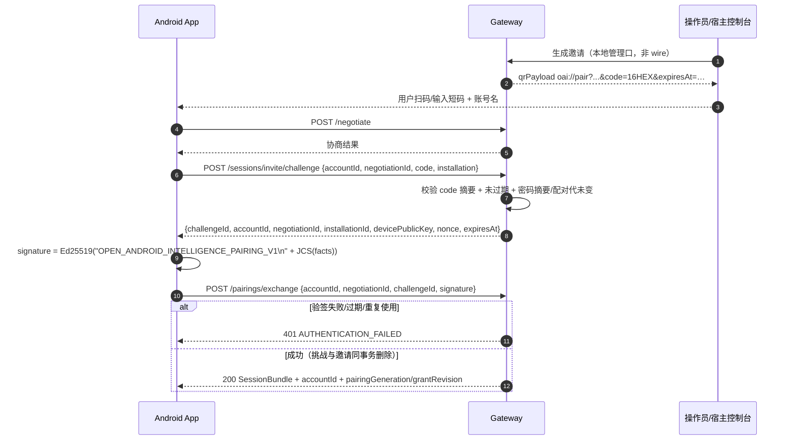
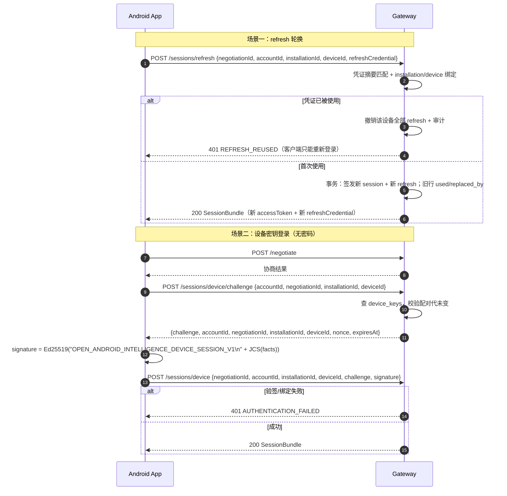
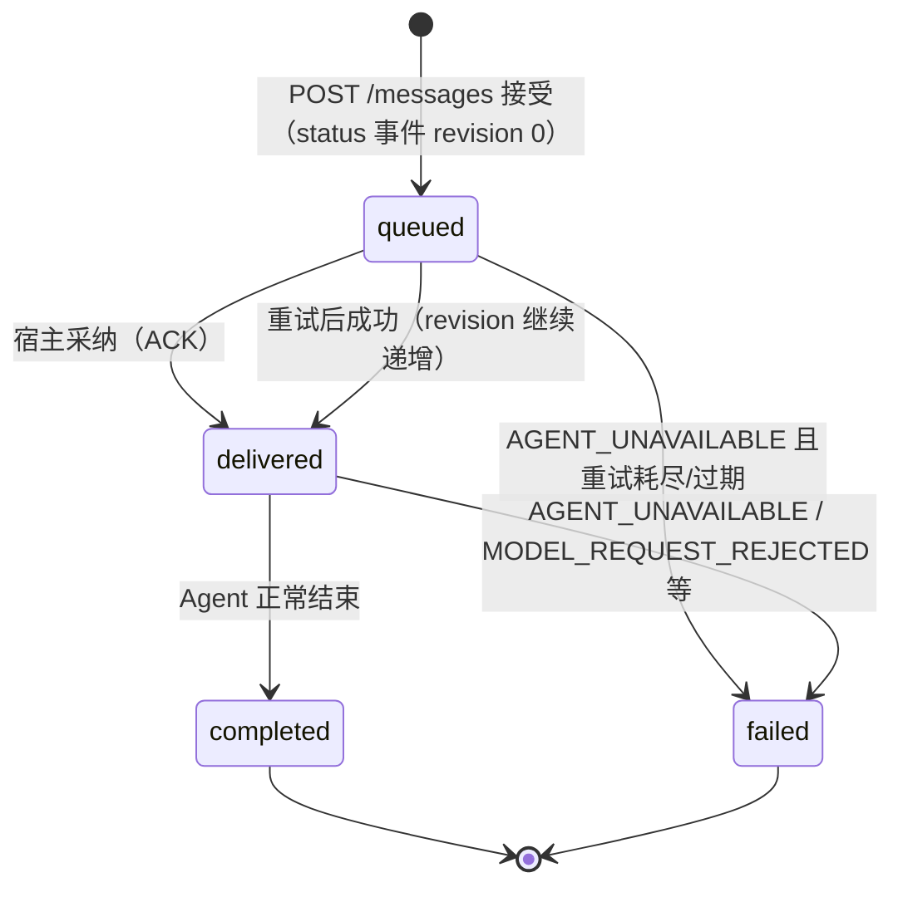
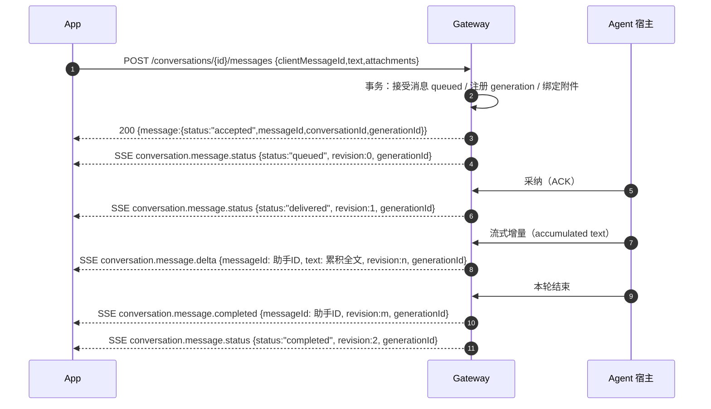

# Open Android Intelligence Gateway Protocol v2.1 —— DSH 服务端实现规格

> 目的：让工程师**不读参考实现源码**也能在 DSH 中实现一个满足 Android App、并通过跨宿主一致性向量的 Gateway 服务端。
>
> 本文所有结论都标了来源。凡未标来源的推论一律不写；凡两材料冲突处单列并说明取舍。

---

## 0. 阅读约定

### 0.1 材料与权威等级

| 代号 | 材料 | 路径 | 权威性 |
|---|---|---|---|
| 【契约】 | 协议契约正文（含 §1–§16 与 §16 子 Schema 全文） | `/mnt/data/projects/open-android-intelligence/docs/contracts/gateway-protocol-v2.md` | **规范真源**（正文级） |
| 【Schema】 | 10 份 JSON Schema（2020-12） | `/mnt/data/projects/open-android-intelligence/gateway-contract/schemas/*.schema.json` | **规范真源**（字段级） |
| 【契约源】 | 契约的 TypeScript 实现：`schema-registry.ts`、`request-signature.ts`、`state-machines.ts`、`core-schema-hash.ts`、`dispatched-schema-validator.ts` | `.../gateway-contract/src/` | **规范真源**（算法级） |
| 【向量】 | 黄金向量（6 个一致性文件 + 2 个 fixture 文件 + 1 个 conversation-ui 文件） | `.../gateway-contract/vectors/` | **规范真源**（可执行断言） |
| 【参考实现·TS】 | OpenClaw 插件（最完整） | `/tmp/dsh-recon/openclaw-gateway-plugin/` | **非强制**，但为事实标准 |
| 【参考实现·Py】 | Hermes 插件 | `/mnt/data/projects/hermes-gateway-plugin/open_android_intelligence_gateway/` | **非强制**，跨宿主差异来源 |
| 【App】 | Android 客户端 `gateway-client` | `/mnt/data/projects/open-android-intelligence/apps/android/` | **兼容性事实**：App 实际发什么、读什么 |

标注约定：

- **【契约强制】**：契约正文或 Schema/向量明确要求。实现必须一致，否则向量失败或 App 拒绝。
- **【参考实现】**：契约未规定、两宿主（或其一）如此实现。DSH 若要与现有 App 互通，应照做；若要自证合规，必须在文档中声明为扩展。
- **【App 事实标准】**：App 已按此收发，但契约正文未写。属于"不照做 App 就坏"的兼容面。
- **【不确定】**：材料不足或两源冲突，已列在 §12。
- **【实现自选】**：契约允许自由选择（如 TTL 具体值、存储结构、ID 生成方式）。

### 0.2 一句话协议模型

**一个账号 = 一个逻辑 Gateway = 一个独立数据域。** 设备用密码/邀请/设备私钥换取短期 access session；之后所有请求用 Ed25519 签名 9 个 header；事件用 SSE（或 WebSocket）按游标续传；对话与附件是"客户端先声明意图、服务端返回权威 ID"的模式；设备能力由 Android 侧发布 schema、Gateway 侧排队请求、设备 claim 后回传结果。

### 0.3 版本与固定摘要

```text
协议版本（envelope.protocol 常量）: "2.1"
协商 protocol: { major: 2, minor: 1 }
core schema hash: sha256:032f580246eb4a214624bded717819b4d5a76191208207edc9e5a4607f5c4d23
```

来源：`gateway-contract/src/core-schema-hash.ts`（算法）+ 本地复算 + `apps/android/.../schema/SchemaContractHash.kt:30`（App 硬编码常量）+ `openclaw-gateway-plugin/plugin-manifest.json:capabilitySchemaHash`。**三处一致，已本地复算验证。**

各文件对 core 摘要的贡献（供实现自检，`sha256` 为**文件原始字节**的 SHA-256）：

```text
attachment.schema.json      sha256:0e6b26cc048d295731b94a7105a5cf2142670095b7f8c1f6ede52355c6997274
conversation.schema.json    sha256:4d9db362af85080eb2d8695be2c4f0faeac44601e2d02ff13c2ab5552de81a8d
device-request.schema.json  sha256:dd815703a5c64be5b44048e691495763145a4c3292fa1e7f4233f8299861db64
envelope.schema.json        sha256:a71b3ca92479a97b810c2c3932156ecbed837e464eb455f4e61f0fc4690cb876
event.schema.json           sha256:1a4ec0fe0e7a574ebe97a38df5f899f6afcde0affa4b3119b5ebf8a90bb25ddc
negotiate.schema.json       sha256:51f77ac51058110fe99123ec61bda6218494a5b9836dea64934dee4364b52327
session.schema.json         sha256:9deb20b4efe6c03ad65787410a75b5a9f3435d07d89ca4bb6caca21dfede5667
```

**实现警告**：只要上述任一文件字节变化（包括换行符、缩进），CORE 就变，Android 端 `SchemaContractHash.CORE` 也必须同步变更，否则每次协商都会被 `PROTOCOL_INCOMPATIBLE` 拒绝，且该拒绝发生在认证前，不会留下会话/审计/事件痕迹。DSH 应把"契约文件字节"作为构建输入而不是手写常量（每文件 digest 已在 §3.2 给出逐步算法）。

### 0.4 材料间的已知漂移（先读这段，避免踩坑）

| # | 现象 | 取舍 |
|---|---|---|
| D1 | 【契约】§6.4 给出的 `expected preimage hex` 解码后是 `AGENT-LIFE-REQUEST-V2` 与 `/agent-life/v2/events...`（旧域名残留），与同节文字规则、`src/request-signature.ts`、`vectors/request-signatures.json#request-signature-oracle` 都不一致 | **以向量与源码为准**：域串是 `OPEN-ANDROID-INTELLIGENCE-REQUEST-V2`，基路径 `/open-android-intelligence/v2` |
| D2 | 【契约】§16 称 dispatched registry "恰好七个 catalog entry"；实际 `vectors/dispatched-schema-fixtures.json` 有 **16** 个 entry，运行时 `core-dispatched-schemas.json` 有 **18** 个 | **以 JSON 文件为准**；§16 该段是早期快照。逐条列在 §4.3 |
| D3 | 【契约】§16 的 `schemaName` 表只列 12 个，而 `vectors/vector-set-1.0.0.schema.json#$defs/schemaName` 列 20 个；`conversation-ui.json` 的 `conversation.commandCatalog`/`conversation.generationCancel`/`conversation.mirrorSync`/`attachment.status` 甚至不在枚举内 | **以 meta-schema + 实际向量文件为准**；`conversation-ui.json` 不在 6 个一致性文件里，不被 `tools/conformance-artifacts.ts` 收录，只被 `test/conversation-ui.test.ts` 使用（§12 有完整清单） |
| D4 | `event.schema.json` 的 `type` 枚举 15 项，**不含** `conversation.generation.cancelled`；但运行时 registry 有它，且 OpenClaw 取消成功时真的会 append | 服务端可选发（App 已按 `conversation.message.status`/`generations/current` 判定终态，不依赖该事件） |
| D5 | 【契约】§7 端点清单列出 `DELETE /attachments/{attachmentId}`；两宿主均未实现，也没有响应 Schema | DSH 建议**不做**（App 不调用），或以 `SCHEMA_INVALID` 明确拒绝；见 §12 |
| D6 | `/sync/snapshot`、`GET/POST /pairings/current*`、`GET /events/ws`、`POST /approvals/{id}/decisions` 不在【契约】正文 | 属【App 事实标准】+【参考实现】扩展。DSH 要服务现有 App **必须实现前三个**；审批端点仅在声明 `agent-approval-cards-v1` 时需要 |
| D7 | `message-batches` 无 JSON Schema；唯一规范是可执行逻辑 `conversation-workflow.ts#validateBatch` + 契约 §7 的 `message-batches-v1`/`newline-v1` 描述 | 按 §5.6 的校验规则实现 |
| D8 | `/conversations/{id}/messages` 响应无 JSON Schema | 按 §5.5 字段表实现（App 读取字段已列全） |
| D9 | 登录/刷新响应无 JSON Schema | 按 §2 的 `SessionBundle` 实现（两宿主字段一致） |
| D10 | `plugin-manifest.json` 声明 `messageBatches:false`、`invitationPairing:false`、`deviceKeySessions:false`，但同一插件的运行时确实提供这些路由与能力 | manifest 是**宿主展示用元数据**，不是 wire 协商结果；协商以 `/negotiate` 的 `features` 交集为准 |

---

## 1. 传输与路由总表

### 1.1 传输

【契约强制】§1、§2：

- 基路径固定 `/open-android-intelligence/v2`；所有端点都在其下（含基路径本身作为前缀判断，见 §1.4 的 canonical target 规则）。
- 默认且唯一可核验身份的传输是 HTTPS；客户端在协商响应拿到 `tlsSpkiSha256` 时必须固定该 SPKI。
- 用户显式输入 `http://` 才允许明文；此时协商必须回 `tlsSpkiSha256: null`，客户端持续显示未加密警告。
- 事件流原生支持 SSE，另一实现还支持 RFC 6455 WebSocket（§4.1）。
- JSON：UTF-8、`Content-Type: application/json`、拒绝重复键、**默认拒绝未知字段**（所有 Schema 都 `additionalProperties: false`）。
- 时间：RFC 3339 UTC，必须**恰好三位毫秒**，正则 `^[0-9]{4}-[0-9]{2}-[0-9]{2}T[0-9]{2}:[0-9]{2}:[0-9]{2}\.[0-9]{3}Z$`。
- 摘要：小写十六进制 SHA-256；`sha256:` 前缀形式用于身份/`core`/`authorKeyId`/事件 parts；**裸 64 hex** 用于 `attachment.create.sha256`。
- wire ID：`^[A-Za-z0-9._~-]{1,128}$`，**不透明**（不得解析前缀含义）。封闭集合包含 `requestId`、`correlationId`、`negotiationId`、`installationId`、`deploymentId`、`accountId`、`deviceId`、`pairingId`、`sessionId`、`conversationId`、`clientConversationId`、`messageId`、`clientMessageId`、`attachmentId`、`clientAttachmentId`、SSE event ID/cursor、设备请求 ID、`claimId`。
- 不属于 wire ID，各自有编码规则：`authorKeyId`/`schemaSha256`/`tlsSpkiSha256`/内容 `sha256`/公钥/签名/凭证、`pluginId`、`capabilityId`、版本、`error.code`。
- 方法：只允许区分大小写的 `GET`/`POST`/`PUT`/`DELETE`，加签名扩展后的 `PATCH`（【契约源】`request-signature.ts` 的 `methods` 含 PATCH；【契约】§6.2 字段语法也含 PATCH）。**不得** `toUpperCase()` 后接受别名。

### 1.2 响应信封

【契约强制】§2 + `schemas/envelope.schema.json#/$defs/success|failure`：

成功（`additionalProperties:false`，四个字段全必填）：

```json
{
  "requestId": "req_01abc",
  "correlationId": "req_01abc",
  "protocol": "2.1",
  "data": {}
}
```

失败（`additionalProperties:false`，`error` 五字段全必填）：

```json
{
  "requestId": "req_01abc",
  "correlationId": "req_01abc",
  "protocol": "2.1",
  "error": {
    "code": "AUTHENTICATION_REQUIRED",
    "message": "AUTHENTICATION_REQUIRED",
    "retryable": false,
    "retryAfterSeconds": null,
    "details": {}
  }
}
```

来源：`schemas/envelope.schema.json:40-77`；两份示例的文字版在【契约】§2。

实现要点：

- `message` **不得**被客户端当作分支依据；参考实现直接把它写成与 `code` 相同的串（`gateway-core.ts:204-222`）。
- `retryable`/`retryAfterSeconds`/`details` 必须**始终存在**（可为 `false`/`null`/`{}`）。
- 【参考实现】`data` 只允许对象；SSE 与附件流用非 JSON 响应体（§4.1、§7.3）。
- 【参考实现】认证前（pre-auth）请求没有已验证身份，`requestId`/`correlationId` 退化为：body 里的 `negotiationId` → 若空则 `"open-android-intelligence-route"`（`gateway-core.ts:171-189`）。DSH 建议保持一致，便于客户端把失败关联回协商。

### 1.3 路由总表

说明：

- "签名"列：**必需** = 需完整 §6.1 九 header + 签名验签；**豁免** = 只校验 `Authorization` + 5 个身份/协议 header（§2.7）；**无** = 认证前端点，不签名。
- "幂等"列：**有** = 必须携带 `Idempotency-Key` 且逐字节等于签名 `requestId`，同键同输入返回原终态；**读** = GET，无幂等键，可安全重试；**协商** = 见 §3.4 的 `negotiationId` 重放语义。
- 请求/响应 Schema 名称取自 `schema-registry.ts` 的 `GatewaySchemaName`；不在其中的标 `—`（无 Schema，字段见对应章节）。

| # | 方法 | 路径（省略基路径） | 用途 | 认证/签名 | 幂等 | 请求 Schema | 响应 `data` 关键字段 |
|---:|---|---|---|---|---|---|---|
| 1 | POST | `/negotiate` | 版本与能力协商 | 无 | 协商 | `negotiate.request` | `negotiate.response` |
| 2 | POST | `/sessions/password` | 密码登录 | 无 | — | `session.password` | SessionBundle（§2.2） |
| 3 | POST | `/sessions/refresh` | 刷新/轮换 | 无 | 可选（§2.4） | `session.refresh` | SessionBundle |
| 4 | DELETE | `/sessions/current?revokeRefresh=…` | 结束会话/退出登录 | **签名豁免** | — | 无 body | `session.logout` |
| 5 | POST | `/sessions/device/challenge` | 取设备挑战 | 无 | — | — | `{challenge, accountId, negotiationId, installationId, deviceId, nonce, expiresAt}` |
| 6 | POST | `/sessions/device` | 设备密钥登录 | 无（签名在 body） | — | `session.device` | SessionBundle |
| 7 | POST | `/sessions/invite/challenge` | 邀请配对取挑战 | 无 | — | — | `{challengeId, accountId, negotiationId, installationId, devicePublicKey, nonce, expiresAt}` |
| 8 | POST | `/sessions/invite/exchange` | 邀请配对兑换会话 | 无（签名在 body） | — | — | SessionBundle |
| 9 | POST | `/pairings/exchange` | 同 #8（**App 实际使用此路径**） | 无 | — | — | SessionBundle |
| 10 | GET | `/events?cursor=…` | 事件流（SSE / JSON） | 必需 | 读 | — | SSE 帧 或 `{events:[…]}` |
| 11 | GET | `/events/ws?cursor=…`（Upgrade） | WebSocket 事件流 | 必需 | 读 | — | 文本帧 `id/event/data` |
| 12 | GET | `/sync/snapshot` | 重建基线快照 | 必需 | 读 | — | `{baselineCursor, conversations, pendingDeviceRequests, pairingGeneration, grantRevision}` |
| 13 | GET | `/commands?languageCode=…` | 命令目录 | 必需 | 读 | — | `command-catalog.schema.json#$defs/catalog` |
| 14 | GET | `/conversations?cursor=&limit=` | 会话列表/分页 | 必需 | 读 | — | `conversation.listPage`（协商 management 时）否则 `{conversations}` |
| 15 | POST | `/conversations` | 新建会话 | 必需 | **有** | `conversation.create` | `{conversation}` |
| 16 | GET | `/conversations/{conversationId}` | 读单个会话 | 必需 | 读 | — | `{conversation}` |
| 17 | PATCH | `/conversations/{conversationId}` | 改标题（body `{title}`） | 必需 | **有** | 无 Schema（§5.3） | `{conversation}` |
| 18 | PATCH | `/conversations/{conversationId}` | 归档/恢复（body `{archived}`） | 必需 | **有** | `conversation.archive` | `{conversation}` |
| 19 | DELETE | `/conversations/{conversationId}` | 删除会话 | 必需 | **有** | 无 body | `{conversationId, deleted:true}` |
| 20 | GET | `/conversations/{id}/messages?cursor=&limit=&clientMessageId=` | 历史分页 | 必需 | 读 | — | `{messages, nextCursor, snapshotRevision}` |
| 21 | POST | `/conversations/{id}/messages` | 发送消息 | 必需 | **有** | `message.create` | `{message:{status:"accepted",messageId,conversationId,generationId?}}` |
| 22 | POST | `/conversations/{id}/message-batches` | 合并发送（换行合并） | 必需 | **有** | 无 Schema（§5.6） | `{batchId, generationId, status:"accepted", members:[…]}` |
| 23 | GET | `/conversations/{id}/generations/current` | 当前生成 | 必需 | 读 | — | `{generation: null | {generationId, conversationId, state}}` |
| 24 | POST | `/conversations/{id}/generations/{generationId}/cancel` | 停止生成 | 必需 | **有** | `conversation.generationCancel` | `{outcome, generationId}` |
| 25 | GET | `/conversation-organization` | 读文件夹/排序 | 必需 | 读 | — | `conversation.organization` |
| 26 | PUT | `/conversation-organization` | 整体替换组织 | 必需 | **有** | `conversation.organizationReplace` | `conversation.organization` |
| 27 | GET | `/conversations/{id}/attachments/{attachmentId}/metadata` | 历史原件元数据 | 必需 | 读 | — | `{metadata:{…}}` |
| 28 | POST | `/conversations/{id}/attachments/{attachmentId}/cache-grant` | 取一次性读取凭据 | 必需 | **有** | 空 body `{}` | `{grantId, expiresAt, metadata}` |
| 29 | GET | `/conversations/{id}/attachments/{attachmentId}/content?grantId=…[&format=stream-v1]` | 读原件 | 必需 | 读 | — | 原始字节（stream）或 `{contentBase64, mediaType}` |
| 30 | POST | `/attachments` | 创建暂存附件 | 必需 | **有** | `attachment.create` | `{attachment:{attachmentId,status,sizeBytes,sha256}}` |
| 31 | PUT | `/attachments/{attachmentId}/content` | 上传字节 | 必需 + 专用 header | **有** | 原始字节（非 JSON） | `{attachment}`（`status:"uploaded"`） |
| 32 | POST | `/attachments/{attachmentId}/commit` | 校验并提交 | 必需 | **有** | 无 body | `{attachment:{…status:"uploaded"}}` |
| 33 | GET | `/attachments/{attachmentId}` | 查询附件状态 | 必需 | 读 | — | `{attachment}` |
| 34 | POST | `/device-requests/{requestId}/claim` | 幂等领取 | 必需 | **有** | 无 body | ClaimReceipt（§8.4） |
| 35 | POST | `/device-requests/{requestId}/result` | 回传结果 | 必需 | **有** | `device.request.resultRequest` | `{deviceRequest:{…}}` |
| 36 | GET | `/device-requests/{requestId}` | 读设备请求 | 必需 | 读 | — | `{request:{…}}` |
| 37 | GET | `/pairings/current` | 读当前配对授权 | 必需 | 读 | — | `{deviceId, pairingGeneration, grantRevision, grantDigest?, …}` |
| 38 | POST | `/pairings/current/capabilities` | 发布能力绑定 | 必需 | **有** | 无 Schema（§8.3） | `{grantRevision, grantDigest}` |
| 39 | DELETE | `/pairings/current` | 解除配对 | 必需（**不豁免**） | **有** | 无 body | `session.unpair` |
| 40 | POST | `/approvals/{approvalId}/decisions` | 命令审批决策 | 必需 | **有** | 无 Schema（§5.9） | `{approval:{approvalId,conversationId,decision,decidedAt}}` |
| 41 | DELETE | `/attachments/{attachmentId}` | 契约列出但未实现 | — | — | — | 见 §12 |

> 实现顺序建议：1–9（认证前）→ 10/12（事件与基线）→ 15/21/20（最小对话闭环）→ 30–33（附件）→ 13/25/26/22–24（会话面）→ 34–39（设备面）→ 40。

### 1.4 路由注册形态

【参考实现】两份宿主都按"精确匹配 + 前缀匹配"注册（`routes.ts:796-823`，`http.py:496-519`）：

```text
exact:  /negotiate, /sessions/invite/challenge, /sessions/invite/exchange,
        /pairings/exchange, /sessions/device/challenge, /sessions/device,
        /sessions/password, /sessions/refresh, /sessions/current,
        /pairings/current, /sync/snapshot, /commands, /events,
        /conversation-organization, /conversations, /attachments
prefix: /pairings/current/, /conversations/, /attachments/, /device-requests/,
        /approvals/（仅 Hermes）
```

DSH 建议：**先做精确表，再对 `prefix` 组做模式匹配**，并在未命中时返回 `SCHEMA_INVALID`（400）而不是裸 404【参考实现】；契约未规定未命中路由的状态码。

### 1.5 认证前（pre-auth）路径集合

【契约强制】§4/§5：这些端点在认证前执行，**永远不进入验签器**，也永远没有 `VerifiedRequestContext`：

```text
POST /negotiate
POST /sessions/password
POST /sessions/refresh
POST /sessions/invite/challenge
POST /sessions/invite/exchange
POST /pairings/exchange
POST /sessions/device/challenge
POST /sessions/device
DELETE /sessions/current
```

【参考实现】`PRE_AUTH_PATHS` 就是同一集合，且**仅** `DELETE` 命中 `/sessions/current`，其余必须 `POST`（`routes.ts:234-247`）。`DELETE /pairings/current` **故意不在集合内**（要完整九 header 签名）。

### 1.6 请求级 header 单例规则

【契约强制】§6.1：必须从 framework 合并/折叠/首末值选择**之前**的 raw header 列表证明下列 14 个 header 的出现次数。任一条重复（哪怕两行完全相同）都拒绝；逗号折叠值、需要 trim 才合法的值、含 CR/LF/NUL 等控制字符的值一律拒绝。宿主拿不到 raw header 列表时必须失败关闭。

**九个认证 header，各恰好一次**：

```text
Authorization
X-Open-Android-Intelligence-Protocol
X-Open-Android-Intelligence-Account
X-Open-Android-Intelligence-Device
X-Open-Android-Intelligence-Session
X-Open-Android-Intelligence-Request-Id
X-Open-Android-Intelligence-Timestamp
X-Open-Android-Intelligence-Nonce
X-Open-Android-Intelligence-Signature
```

**五个条件 header，按路由决定**：

| header | 规则 |
|---|---|
| `Idempotency-Key` | 已认证 `POST`/`PUT`/`PATCH`/`DELETE`：恰好一次，值必须逐字节等于签名 `requestId`；已认证 `GET`：**不得出现** |
| `Last-Event-ID` | 仅 `GET /events` 且 canonical query 已含非空 `cursor` 时出现 0 或 1 次；出现时必须逐字节等于 cursor；其他路由不得出现 |
| `Content-Type` | 声明 JSON body 的路由：恰好一次，值精确 `application/json`；`PUT /attachments/{id}/content`：0 或 1 次，出现时必须精确等于创建附件时登记的 `mediaType`；无 body 路由不得出现 |
| `Content-Length` | `PUT /attachments/{id}/content`：恰好一次；其他有 body 路由：0 或 1 次（取决于 transfer framing）；无 body 路由不得出现 |
| `Digest` | **仅** `PUT /attachments/{id}/content`：恰好一次；其他路由不得出现 |

【参考实现】OpenClaw 在验签器里对 rawHeaders 逐对扫描，遇到重复的 singleton 或任何 `x-open-android-intelligence-*` 直接返回 `undefined`（即 `AUTHENTICATION_REQUIRED`），见 `request-verifier.ts:10-17`；附件内容路由另外要求 `Content-Length` 与 `Digest` 各恰好一次、且禁止 `Content-Encoding`/`Transfer-Encoding`（`routes.ts:388-407`）。

---

## 2. 鉴权与配对流程

### 2.1 身份与信任根

【契约强制】§5.1 / §6.1 / §12：

| 标识 | 含义 | 谁生成 | 备注 |
|---|---|---|---|
| `accountId` | 逻辑 Gateway 的稳定隔离主键 | Gateway | 账号名前缀只是示例，不构成编码规则 |
| `username` | 可变登录名 | 用户 | **不作为数据隔离键**；不属于 wire ID |
| `installationId` | 首次安装生成的本地标识 | Android | 不同账号中的相同值不共享 device/配对/授权/审计 |
| `deviceId` | 该安装实例在本账号内的设备标识 | Gateway | — |
| `pairingId` | 账号与设备之间的信任关系 | Gateway | 客户端不得本地合成 |
| `pairingGeneration` | 重配对/轮换/恢复后单调递增 | Gateway | 旧 generation 请求 → `PAIRING_GENERATION_STALE` |
| `grantRevision` | 单次配对的授权版本，单调递增 | Gateway | 旧 revision → `GRANT_STALE` |
| `sessionId` | 短期认证会话 | Gateway | 15 分钟【参考实现】 |
| `accessToken` | Bearer 凭证 | Gateway | 只存摘要，不存明文【参考实现】 |
| `refreshCredential` | 轮换用凭证 | Gateway | 只存摘要；一次性 |

**信任根（服务端侧）**【参考实现】`session-service.ts`：

1. **设备公钥是唯一长期签名根**：`devicePublicKey` 在密码登录/邀请兑换时随 `installation` 提交，注册进 `device_keys`，同一事务内签发会话（`session-service.ts:365-391`）。后续所有请求用该公钥验签。
2. **服务端不持有设备私钥，也不做公钥基础设施**：Ed25519 32 字节公钥，base64url 无填充，43 字符（正则 `^[A-Za-z0-9_-]{42}[AEIMQUYcgkosw048]$`，见 `envelope.schema.json:32-35`）。
3. **TLS 身份是传输层信任根**：部署配置 `OPEN_ANDROID_INTELLIGENCE_GATEWAY_TLS_SPKI_SHA256=sha256:<64 hex>`（OpenClaw 亦支持 `pluginConfig.tlsSpkiSha256`），协商回传；全零摘要非法（`negotiate.schema.json:267-284`，向量 `protocol-negotiate-zero-tls-identity-is-not-a-certificate`）。
4. **密码**：只存摘要（`credentials.ts`）；密码重置撤销该账号全部 refresh credential。
5. **refresh credential**：只存 SHA-256 摘要；用后立即置 `used`；检测到重复使用 → 撤销该设备**全部** refresh credential + 审计 + `REFRESH_REUSED`（`session-service.ts:393-411`）。
6. **access token**：只存摘要；`resolveSession` 用 `timingSafeEqual` 比较。

### 2.2 密码登录 `POST /sessions/password`

【契约强制】§5.2 + `schemas/session.schema.json#/$defs/password`：只能在正式验证的 TLS 上调用。请求（`additionalProperties:false`，四字段全必填）：

```json
{
  "negotiationId": "neg_01abc",
  "username": "alice",
  "password": "user-entered-secret",
  "installation": {
    "installationId": "install_01abc",
    "displayName": "Alice's phone",
    "devicePublicKey": "AAAAAAAAAAAAAAAAAAAAAAAAAAAAAAAAAAAAAAAAAAA"
  }
}
```

来源：`schemas/session.schema.json:5-29`；有效值与"无效签名"反例见 `vectors/auth-sessions.json#auth-session-password-valid`。

前置条件（**【参考实现】+【契约强制】§4"协商结果由 negotiationId 绑定后续认证会话"**）：

1. 该 `negotiationId` 必须已存在且未过期（TTL 5 分钟），并且其绑定的 `installationId` 必须等于请求中的 `installationId`；否则 `PROTOCOL_INCOMPATIBLE`（`gateway-core.ts:713-731`）。
2. `username` 对应的账号必须**已存在**——登录**永不创建账号**；不存在 → `AUTHENTICATION_FAILED`（不泄露账号是否存在）。
3. `devicePublicKey` 必须是 canonical base64url 的 32 字节（43 字符、重新编码一致），否则 `AUTHENTICATION_FAILED`/`SCHEMA_INVALID`（`session-service.ts:357-363`）。
4. 密码摘要校验失败 → `AUTHENTICATION_FAILED`；比较使用 `timingSafeEqual`。
5. 【参考实现】限流：账号级同时最多 2 个密码/挑战任务；同 peer+account 每分钟最多 30 次；超出 → `RATE_LIMITED`（429）。

成功响应（**【参考实现】**，字段由两宿主一致给出；契约只规定"返回短期 access token、一次性 refresh credential 和配对摘要"，未给 Schema）：

```json
{
  "requestId": "neg_01abc",
  "correlationId": "neg_01abc",
  "protocol": "2.1",
  "data": {
    "sessionId": "sess_6f1c2a9e-...",
    "deviceId": "dev_9b2d...",
    "accessToken": "access_5Kk...",
    "refreshCredential": "refresh_9Qz...",
    "expiresAt": "2026-08-27T00:15:00.000Z",
    "accountId": "alice",
    "pairingGeneration": 1,
    "grantRevision": 1
  }
}
```

字段规则：

- `expiresAt` 必须三位毫秒（参考实现 = 签发时刻 + 15 分钟）。
- `pairingGeneration`/`grantRevision` 从**当前有效状态**读取（不是快照）；参考实现登录后 `grantRevision` 从 `device_keys` 读。
- 【App】`parseSessionCredentials` 接受 `accessToken` 或 `token`，并读取**可选** `pairingSummary`（字符串）——两宿主都不返回 `pairingSummary`，App 用默认值；DSH 可省略，若返回必须是字符串。
- 新设备的核心对话与附件可用，但**设备插件授权集合为空**（`grantRevision` 初始 1、无 bindings）。
- 同一 `installationId` 重复登录：参考实现每次 `issue()` 都生成新的 `dev_<uuid>`，因此**每次登录都会新建一个 `deviceId`**（不会复用旧设备记录；`registerDeviceKey` 的 `ON CONFLICT(device_id)` 因键是全新 UUID 而不会命中）。旧 `deviceId` 的密钥与授权保留，可能形成同 `installationId` 的多条设备记录。【不确定】契约未规定该复用语义，见 §12 U4。

时序图：

```mermaid
sequenceDiagram
    autonumber
    participant A as Android App
    participant G as Gateway
    participant DB as account DB

    A->>G: POST /negotiate {negotiationId, protocol, client, features, schemaHashes.core}
    G->>DB: 记录 pending negotiation (installationId, inputHash, +5min)
    G-->>A: {protocol, features, limits, gatewayIdentity{tlsSpkiSha256}}
    A->>A: 校验 core hash / tlsSpki 固定 / 能力交集
    A->>G: POST /sessions/password {negotiationId, username, password, installation}
    G->>G: 校验 negotiationId 存在 + installationId 绑定
    G->>DB: 账号存在？密码摘要校验（timingSafeEqual）
    alt 任一步失败
        G-->>A: 4xx {error.code: AUTHENTICATION_FAILED / PROTOCOL_INCOMPATIBLE}
    else 成功
        G->>DB: BEGIN; 插入 access_session(仅存 token 摘要); 插入 refresh_credential(仅存摘要); 注册 device_keys(pubkey, generation)
        G->>DB: COMMIT; 审计 session.password.created
        G-->>A: 200 {sessionId, deviceId, accessToken, refreshCredential, expiresAt, accountId, pairingGeneration, grantRevision}
        A->>A: Keystore 保存 device 私钥；保存 refreshCredential + 摘要
    end
```

### 2.3 邀请配对

【契约强制】§5.3：二维码/短码由**目标账号**生成，含 Gateway 地址、账号提示、邀请 ID、一次性秘密、期限、Gateway 身份指纹；邀请只能使用一次、不能跨账号、默认 5 分钟失效；成功响应与密码登录相同，审计认证方式为 `account-invitation`。

【参考实现】`pairing-invites.ts` 给出可执行细节（App 已按此实现）：

- 邀请码：16 位大写十六进制（8 随机字节），服务端只存 `sha256(code)` 作为 key。
- 二维码 payload：`oai://pair?gateway=<url>&account=<id>&invitationId=…&code=…&expiresAt=…&identityFingerprint=sha256:<JCS(gatewayIdentity)>`。
- 邀请 TTL 默认 300 秒，允许 30–900；存活邀请上限 128，超出 → `RATE_LIMITED`。
- 挑战 TTL = `min(now+60s, 邀请过期时刻)`。
- 邀请与挑战都绑定**当前密码摘要**和**当前 pairingGeneration**：期间改密码或重配对会使旧邀请/挑战失效（`AUTHENTICATION_FAILED`）。

#### 2.3.1 `POST /sessions/invite/challenge`

请求（**【参考实现】**，App 精确发送这 4 个字段）：

```json
{
  "accountId": "alice",
  "negotiationId": "neg_01abc",
  "code": "A1B2C3D4E5F60718",
  "installation": {
    "installationId": "install_01abc",
    "displayName": "Alice's phone",
    "devicePublicKey": "AAAAAAAAAAAAAAAAAAAAAAAAAAAAAAAAAAAAAAAAAAA"
  }
}
```

成功响应（**【参考实现】**；App 校验字段集合**恰好**是下列 7 个，并核对 `accountId`/`negotiationId`/`installationId`/`devicePublicKey`、要求 `expiresAt` 在未来 120 秒内）：

```json
{
  "protocol": "2.1",
  "requestId": "neg_01abc",
  "correlationId": "neg_01abc",
  "data": {
    "challengeId": "challenge_1f0e...",
    "accountId": "alice",
    "negotiationId": "neg_01abc",
    "installationId": "install_01abc",
    "devicePublicKey": "AAAAAAAAAAAAAAAAAAAAAAAAAAAAAAAAAAAAAAAAAAA",
    "nonce": "q83v...32bytes...",
    "expiresAt": "2026-08-27T00:01:00.000Z"
  }
}
```

#### 2.3.2 `POST /sessions/invite/exchange` 与 `POST /pairings/exchange`

两者**同一处理器、同一语义**；【App】实际把兑换发到 `/pairings/exchange`。请求（**【参考实现】**；`additionalProperties` 在实现里按精确键集合校验，多余键 → `SCHEMA_INVALID`）：

```json
{
  "accountId": "alice",
  "negotiationId": "neg_01abc",
  "challengeId": "challenge_1f0e...",
  "signature": "base64url-ed25519-86chars..."
}
```

签名预像（**【参考实现】**，App 完全一致，见 `pairing-invites.ts:53` 与 `GatewayAuthClient.kt`）：

```text
ASCII("OPEN_ANDROID_INTELLIGENCE_PAIRING_V1") LF
ASCII(JCS(challengeFacts))
```

其中 `challengeFacts` 就是上一节返回的**完整 7 字段对象**（含 `nonce`、`expiresAt`、`devicePublicKey`），JCS = RFC 8785 规范化 JSON（键排序、无多余空白、UTF-8）。

服务端校验顺序（`pairing-invites.ts:44-57`）：挑战存在且未过期 → `facts.negotiationId` 匹配 → 邀请未过期且密码摘要/pairingGeneration 仍当前 → 严格 base64url 86 字符签名 → Ed25519 验签 → **删除挑战与邀请** → 同事务签发 `createInviteSession`。任一步失败一律 `AUTHENTICATION_FAILED`（不区分原因）。

成功响应：与 §2.2 相同的 SessionBundle，另加 `accountId`，`pairingGeneration`/`grantRevision` 取当前值。



### 2.4 刷新与设备密钥会话

#### `POST /sessions/refresh`

【契约强制】§5.4 + `schemas/session.schema.json#/$defs/refresh`（五字段全必填）：

```json
{
  "negotiationId": "neg_01abc",
  "accountId": "alice",
  "installationId": "install_01abc",
  "deviceId": "dev_9b2d...",
  "refreshCredential": "refresh_9Qz..."
}
```

来源：`schemas/session.schema.json:31-56`，有效值见 `vectors/auth-sessions.json#auth-session-refresh-valid`。

行为：

1. 按 `sha256(refreshCredential)` 查行；`installationId`/`deviceId` 必须逐字节匹配，否则 `AUTHENTICATION_FAILED`。
2. 若该凭证状态不是 `active`（已被轮换过）→ **记录重放**：撤销该 `(installation, device)` 全部 refresh credential、写审计、抛 `REFRESH_REUSED`（401）。
3. 成功：**同一事务**内签发新 session + 新 refresh credential，并把旧行置 `used`、`replaced_by_hash = sha256(new)`。
4. 响应 = 新 SessionBundle + `accountId` + 当前 `pairingGeneration`/`grantRevision`。
5. 【参考实现】访问令牌 15 分钟；`expiresAt` 三位毫秒。
6. 【参考实现】Hermes 还要求 `negotiationId` 已绑定（`bind_negotiation`），OpenClaw 的 refresh 不检查 pending negotiation。**DSH 建议按契约 §4 要求绑定**（客户端每次刷新前都会重新协商），并允许"协商已过期但凭证有效"以实现长离线恢复？→ 属【不确定】，见 §12。

#### 刷新结果安全重放扩展（`Refresh-Replay`）

【契约强制】§5.4 扩展节（**不改变 JSON body 或 Schema**）：

- 客户端在 `POST /negotiate` 上可发送**恰好一个** header `X-Open-Android-Intelligence-Refresh-Replay: v1`。
- Gateway 只有在"该账号的 AEAD 加密持久化已配置并能保护重放结果"时，才在协商响应回**恰好一个**同名、值 `v1` 的 header；未请求时**不应**回；重复或不支持的值必须拒绝协商。
- 缺失响应 header = 服务端不支持；其他值或重复响应 header 不表示支持。
- 客户端只有收到该响应 header 后，才可为 `POST /sessions/refresh` 发送 `Idempotency-Key`（wire ID 语法、稳定不透明标识、恰好一次、不得逗号折叠、逻辑刷新全程不变）。
- 幂等作用域：`accountId + installationId + deviceId + Idempotency-Key`；输入绑定**当前 refresh credential 的密码学摘要**与这三个身份字段，**不含 `negotiationId`**（因此重启后重新协商仍可重放）。
- 必须**同一 SQLite 事务**内轮换凭证并以 AEAD 加密保存完整轮换结果；DB 内不得明文保存 access token/refresh credential。
- 相同作用域相同输入 → 返回原 session/token/凭证/有效期，**不得再轮换**；配对与授权 revision 从**当前有效状态**读取。相同作用域不同输入 → `IDEMPOTENCY_CONFLICT`。
- 重放只在后继状态仍有效时允许：successor refresh credential、它签发的 access session、设备配对都必须仍 active，且 successor 未被再次轮换；否则拒绝（不能用重放复活已撤销会话）。
- 用**旧** refresh credential 搭配**不同** `Idempotency-Key` 仍按重复使用处理并撤销全部 refresh credential。
- 必须串行化同一作用域的并发请求。
- 支持扩展但账号未启用 AEAD 时，收到该 header 必须在**轮换前**拒绝。

【参考实现】**两宿主当前都未实现该扩展**（协商不回该 header；`http.py`/`gateway-core.ts` 均无 `Refresh-Replay` 分支）。DSH 若要实现，须自行补充并保证上面每一条；不实现时**绝不能回应该 header**。

#### `POST /sessions/device/challenge` 与 `POST /sessions/device`

【契约强制】§5.4：`POST /sessions/device` 用**已配对设备私钥**签名挑战建立短期会话；请求仍必须携带账号名或账号 ID；设备密钥不能跨账号探测或复用。

挑战请求（**【参考实现】**，App 精确发送这 4 个字段）：

```json
{
  "accountId": "alice",
  "negotiationId": "neg_01abc",
  "installationId": "install_01abc",
  "deviceId": "dev_9b2d..."
}
```

挑战响应（**【参考实现】**；App 校验字段集合**恰好** 7 个并核对 scope，TTL ≤ 120 秒）：

```json
{
  "protocol": "2.1",
  "requestId": "neg_01abc",
  "correlationId": "neg_01abc",
  "data": {
    "challenge": "challenge_5c7a...",
    "accountId": "alice",
    "negotiationId": "neg_01abc",
    "installationId": "install_01abc",
    "deviceId": "dev_9b2d...",
    "nonce": "5m2...32bytes...",
    "expiresAt": "2026-08-27T00:01:00.000Z"
  }
}
```

注意：设备挑战的挑战键名是 **`challenge`**（邀请挑战是 `challengeId`），且多一个 `deviceId`。

兑换请求（**【契约强制】** `session.device` Schema，六字段必填，`additionalProperties:false`，且 `accountId`/`username` 二选一 —— `oneOf`，见 `session.schema.json:57-92`）：

```json
{
  "negotiationId": "neg_01abc",
  "accountId": "alice",
  "installationId": "install_01abc",
  "deviceId": "dev_9b2d...",
  "challenge": "challenge_5c7a...",
  "signature": "base64url-ed25519-86chars..."
}
```

签名预像（**【参考实现】**，App 一致）：

```text
ASCII("OPEN_ANDROID_INTELLIGENCE_DEVICE_SESSION_V1") LF
ASCII(JCS(challengeFacts))
```

服务端校验（`pairing-invites.ts:67-79`）：挑战存在未过期 → `device_keys` 里 `(deviceId, installationId)` 行存在且 `public_key`/`pairing_generation` 与保存的一致 → 密码摘要仍当前 → 请求的 `challenge`/`negotiationId`/`installationId`/`deviceId` 与挑战 facts **逐字段相等** → 严格 base64url 签名 → 验签 → 删除挑战 → 签发设备会话（`session.device.created` 审计）。

失败一律 `AUTHENTICATION_FAILED`。



### 2.5 登出 `DELETE /sessions/current`

【契约强制】§5.5 + Wave 0 D4：

- 结束当前 access session；canonical query 含 `revokeRefresh=true` 时同时撤销该设备的 refresh credential（"退出登录"）。
- **签名豁免**：保留 `Authorization` + Protocol + Account + Device + Session 绑定校验；**豁免** `Timestamp`、`Nonce`、`Signature`、`Request-Id`、`Idempotency-Key`。
- 该豁免是**逐路由**的，绝不按方法或前缀泛化；`DELETE /pairings/current` 仍要完整九 header。
- 只终止已验证的当前会话，**不删除配对**。

请求（【App】实际发送，见 `GatewayAuthClient.kt#logout`）：

```http
DELETE /open-android-intelligence/v2/sessions/current?revokeRefresh=true HTTP/1.1
Authorization: Bearer access_5Kk...
X-Open-Android-Intelligence-Protocol: 2.1
X-Open-Android-Intelligence-Account: alice
X-Open-Android-Intelligence-Device: dev_9b2d...
X-Open-Android-Intelligence-Session: sess_6f1c2a9e-...
Accept: application/json
```

成功响应（**【契约强制】** `session.logout` Schema，两字段必填）：

```json
{
  "requestId": "req_logout",
  "correlationId": "req_logout",
  "protocol": "2.1",
  "data": {
    "sessionId": "sess_6f1c2a9e-...",
    "refreshRevoked": true
  }
}
```

来源：`schemas/session.schema.json:93-104`；向量 `vectors/auth-sessions.json#auth-session-logout-valid`（`refreshRevoked:true`）与 `#auth-session-logout-unknown-field`（多字段 → `SCHEMA_INVALID`）。

服务端步骤【参考实现】`gateway-core.ts:782-816`：

1. 从 header 读 `account`/`device`/`session`/`Authorization: Bearer`，缺任一 → `AUTHENTICATION_REQUIRED`。
2. 账号不存在 → `AUTHENTICATION_FAILED`。
3. 用 `accessToken` 校验 `(sessionId, deviceId)`，失败 → `AUTHENTICATION_FAILED`。
4. `revokeSession(sessionId)`：置 `revoked`，写审计，并向**该 session 所属的真实 deviceId**（从 DB 读，不信任调用方）append `session.revoked` 事件。
5. `revokeRefresh=true` 时 `revokeRefreshCredentials(deviceId)`。
6. 返回 `{sessionId, refreshRevoked}`（`refreshRevoked` = 是否请求了撤销，而非"是否确有凭证被撤销"）。

### 2.6 解除配对 `DELETE /pairings/current`

【契约强制】§5.6 / §13 + `session.unpair` Schema。请求无 body、无路径参数（设备只能来自已验证上下文），必须完整九 header 签名 + `Idempotency-Key`。

成功响应（七字段全必填）：

```json
{
  "requestId": "req_unpair",
  "correlationId": "req_unpair",
  "protocol": "2.1",
  "data": {
    "deviceId": "dev_9b2d...",
    "deviceKeysRevoked": true,
    "refreshRevoked": true,
    "grantsRevoked": true,
    "deviceRequestsRevoked": true,
    "unconfirmedAttachmentsRevoked": true,
    "sessionsRevoked": true
  }
}
```

来源：`schemas/session.schema.json:105-129`；向量 `vectors/auth-sessions.json#auth-session-unpair-valid` 与 `#auth-session-unpair-missing-field`。

【参考实现】每个布尔值是**事后观测**而非"打算"：事务结束后重新读库，确认该类对象已不存在才为 `true`（`pairing-service.ts:163-171`）。撤销顺序（同一事务）：设备密钥 → refresh credential → grants（本实现无独立表，密钥行删除即无授权）→ 设备请求队列 → 未确认附件与暂存字节 → 该设备**全部** access session → `pairingGeneration += 1` → 审计。错误优先级（`gateway-core.ts:459-483`）：有 body → `SCHEMA_INVALID`；无配对 → `PAIRING_REQUIRED`；会话过期/已撤销/未知 → `SESSION_EXPIRED`/`SESSION_REVOKED`/`AUTHENTICATION_FAILED`。

### 2.7 请求签名（九个 header 的精确算法）

#### 2.7.1 header 取值语法

【契约强制】§6.2：

```text
method    = "GET" / "POST" / "PUT" / "PATCH" / "DELETE"        (线上区分大小写)
timestamp = RFC3339 UTC，恰好三位毫秒
nonce     = canonical unpadded base64url，恰好 16 字节
signature = canonical unpadded base64url，恰好 64 字节（Ed25519）
```

- nonce 与 signature 解码后字节数必须精确；**重新编码必须与原串完全相同**（拒绝非 canonical 编码、拒绝 `=` 填充）。
- body digest 覆盖 **HTTP transfer framing 解码后的 exact entity-body 字节**，且必须在 JSON decode、字符转换、自动解压、重序列化**之前**计算。JSON 请求**禁止** `Content-Encoding`。
- 零字节 body 的 SHA-256 固定为 `e3b0c44298fc1c149afbf4c8996fb92427ae41e4649b934ca495991b7852b855`。

#### 2.7.2 canonical request target

【契约强制】§6.3（10 步逐字节算法，与 `src/request-signature.ts:88-156` 等价）：

1. 拒绝 absolute-form、authority-form、`*`、fragment（`#`）、空白与控制字符；path 必须是 `/open-android-intelligence/v2` 或其下级。
2. 只在**第一个**字面量 `?` 分离 path/query；query 内出现字面量 `?` → `SCHEMA_INVALID`。
3. path 用字面量 `/` 分段；每个完整 `%HH` 解码为一个 byte；畸形/不完整 percent escape → `SCHEMA_INVALID`。
4. byte ∈ `[A-Za-z0-9._~-]` 原样输出，其余输出**大写** `%HH`。
5. 拒绝解码后为 `.` 或 `..` 的 segment；拒绝 segment 解码后含 `/` 或 `\`；拒绝 `//` 与非根尾随 `/`。
6. query 用字面量 `&` 分 pair，空 pair 拒绝；在第一个字面量 `=` 分 name/value，空 name 拒绝；未写 `=` 规范为 `name=`。
7. query name/value 用与 3、4 相同的字节解码/编码；`+` 规范为 `%2B`，**绝不**当空格。
8. 先按 canonical name 的 ASCII bytes 排序，再按 canonical value 的 ASCII bytes 排序；完全重复的 pair **保留原数量**（稳定排序按输入序）。
9. 无 query 时不输出 `?`；字面量空 query 标记 `?` **必须拒绝**。
10. 客户端实际发送的 raw target 与 Gateway 验签读到的 raw target 都必须**逐字节等于** canonical target；反向代理不得依赖未认证的 `X-Original-URI` 恢复路径。

向量（**【向量】**`vectors/request-signatures.json`）：

```json
{
  "target": "/open-android-intelligence/v2/events?z=last&cursor=evt_1"
}
```

规范化结果：

```json
{
  "canonicalTarget": "/open-android-intelligence/v2/events?cursor=evt_1&z=last"
}
```

来源：`#request-target-sort`。空 query 反例：`"/open-android-intelligence/v2/events?"` → `SCHEMA_INVALID`（`#request-target-invalid-query`）。

#### 2.7.3 签名预像（10 个 ASCII 字段 + 9 个 LF）

【契约强制】§6.4：

```text
ASCII("OPEN-ANDROID-INTELLIGENCE-REQUEST-V2") LF
ASCII(method) LF
ASCII(canonicalTarget) LF
ASCII(accountId) LF
ASCII(deviceId) LF
ASCII(sessionId) LF
ASCII(requestId) LF
ASCII(timestamp) LF
ASCII(nonce) LF
ASCII(lowercaseHex(SHA-256(exactBodyBytes)))
```

- 最后一个字段后**不得**出现 LF、CR、NUL、空格或 BOM。
- Ed25519 **直接签完整预像**，不使用 Ed25519ph。
- 公钥是 32 字节 Ed25519，包成 SPKI DER 前缀 `302a300506032b6570032100` 后验签【参考实现】。

对照向量（**【向量】**`vectors/request-signatures.json#request-signature-oracle`）：

```json
{
  "method": "GET",
  "target": "/open-android-intelligence/v2/events?cursor=evt_1&z=last",
  "accountId": "acct_1",
  "deviceId": "dev_1",
  "sessionId": "sess_1",
  "requestId": "req_1",
  "timestamp": "2026-08-27T00:00:00.000Z",
  "nonce": "AAAAAAAAAAAAAAAAAAAAAA",
  "bodyHex": ""
}
```

其 preimage（hex，转写为文本即上面 10 行）：

```text
4f50454e2d414e44524f49442d494e54454c4c4947454e43452d524551554553542d56320a4745540a2f6f70656e2d616e64726f69642d696e74656c6c6967656e63652f76322f6576656e74733f637572736f723d6576745f31267a3d6c6173740a616363745f310a6465765f310a736573735f310a7265715f310a323032362d30382d32375430303a30303a30302e3030305a0a414141414141414141414141414141414141414141410a65336230633434323938666331633134396166626634633839393666623932343237616534316534363439623933346361343935393931623738353262383535
```

非空 body 的 oracle（`bodyHex = "007b7d2b25ff80c3a9"`，其 SHA-256 以 `0a460f...` 结尾）见 `#request-signature-nonempty-body`。

非规范 target 反例（`?z=last&cursor=evt_1`）→ `NON_CANONICAL_TARGET`（`#request-signature-noncanonical`）。

#### 2.7.4 服务端验签顺序

【契约强制】§6.1–§6.5 +【参考实现】`request-verifier.ts`：

1. 逐条扫描 raw headers：出现重复的 singleton 或重复 `x-open-android-intelligence-*` → 拒绝；值含 CR/LF → 拒绝。
2. `X-Open-Android-Intelligence-Protocol` 必须**精确** `2.1`，否则 `AUTHENTICATION_REQUIRED`。
3. `Authorization` 必须 `Bearer <token>`，且 token 前后不得有空白（`slice(7).trim() !== slice(7)` → 拒绝）。
4. 时间窗：`|now - timestamp| <= 120_000 ms`，否则 `CLOCK_SKEWED`（401）。窗口值同时出现在协商 `limits.maxClockSkewSeconds`，两处必须一致。
5. 构造预像：附件内容路由用 **Digest header 声明的 sha256**（不读 body），其他路由用实际 body bytes 的 SHA-256。
6. signature 必须 `^[A-Za-z0-9_-]{86}$` 且 canonical base64url（86 字符 = 64 字节无填充）。
7. 账号存在？不存在 → `AUTHENTICATION_REQUIRED`（不泄露）。
8. `resolveSession(accessToken, sessionId, deviceId)`：会话 active、未过期、token 摘要 `timingSafeEqual` 匹配、设备公钥存在；失败一律 `AUTHENTICATION_REQUIRED`。
9. 用设备公钥验 Ed25519 预像，失败 → `SIGNATURE_INVALID`（401）【参考实现实际返回 `AUTHENTICATION_REQUIRED`，见 §9.4 说明】。
10. nonce 防重放：删除过期 nonce（TTL 240 s = 2×时间窗）→ 表内行数 ≥ 10000 → `RATE_LIMITED` → 插入 `sha256(nonce)`；**主键冲突即 `REQUEST_REPLAYED`**（401）。
11. 身份一致性：token 解出的 `accountId`/`deviceId`/`sessionId` 必须与三个身份 header **逐字节相等**。
12. 产出唯一不可变 `VerifiedRequestContext{accountId, deviceId, sessionId, requestId, correlationId=requestId, pairingGeneration, grantRevision}`；后续路由**不得**再从 header/query/path/JSON 读身份。
13. body 中出现 `accountId`/`deviceId`/`principalId`/`pairingGeneration`（去分隔符、大小写不敏感、递归 ≤ 8 层）→ `IDENTITY_OVERRIDE_REJECTED`（`gateway-core.ts:367-385`）。

> **nonce 表的存储建议**：`request_nonces(device_id, nonce_hash, expires_at)`，`PRIMARY KEY(device_id, nonce_hash)` 或唯一索引；用插入冲突判定重放，避免"先查后插"的竞态。

### 2.8 幂等绑定

【契约强制】§6.5：

- 读请求可安全重试。
- 所有创建、副作用、附件提交请求必须携带 `Idempotency-Key`，值**逐字节精确等于**已签名的 `X-Open-Android-Intelligence-Request-Id`。
- 同一账号、设备、request ID 在保留期内返回同一终态，不重复执行。
- 客户端重试可更换 `timestamp` 与 `nonce`，但必须保持 request ID 不变。

【参考实现】`runIdempotent`（`gateway-core.ts:391-442`）：

- GET 直接执行，不记账。
- 非 GET：若 `Idempotency-Key !== requestId` → `IDEMPOTENCY_CONFLICT`。
- 输入摘要 `inputHash = sha256(JCS({method, target, body}))`。
- 账本键 `(device_id, request_id)`，保存 `{input_hash, outcome_json(加密封装), expires_at}`；保留 **30 天**。
- 命中：`input_hash` 不同 → `IDEMPOTENCY_CONFLICT`；已过期 → `OUTCOME_UNKNOWN`；否则返回原终态（可再经 `validateReplay` 校验 claim/result 绑定）。
- 未命中：执行 `work()`；只有白名单错误码（`SCHEMA_INVALID`、`PAIRING_REQUIRED`、`GRANT_STALE`、`IDEMPOTENCY_CONFLICT`、`CONVERSATION_*`、`CURSOR_*`、`ATTACHMENT_DIGEST_MISMATCH`、`ATTACHMENT_EXPIRED`、`OUTCOME_UNKNOWN` 等）才把失败也记成终态；其他错误抛出且**不记账**（允许重试）。

---

## 3. 协商与能力声明

### 3.1 `POST /negotiate`

【契约强制】§4 + `schemas/negotiate.schema.json`。认证前执行，请求不含秘密。

请求（`additionalProperties:false`；`negotiationId`、`protocol`、`client`、`features`、`schemaHashes` 全必填）：

```json
{
  "negotiationId": "neg_1",
  "protocol": { "major": 2, "minor": 1 },
  "client": {
    "installationId": "install_1",
    "appVersion": "2.1.0",
    "platform": "android",
    "platformApi": 35
  },
  "features": {
    "auth": ["password", "account-invitation", "refresh", "device-key"],
    "messages": ["chat-v1"],
    "attachments": ["staged-sha256-v1"],
    "events": ["sse-cursor-v1"],
    "deviceRequests": ["risk-queue-v1"],
    "conversationUi": [
      "agent-command-catalog-v1",
      "agent-command-new-v1",
      "agent-approval-cards-v1",
      "message-batches-v1",
      "newline-v1",
      "generation-cancel-v1",
      "conversation-management-v1"
    ]
  },
  "schemaHashes": {
    "core": "sha256:032f580246eb4a214624bded717819b4d5a76191208207edc9e5a4607f5c4d23"
  }
}
```

来源：`schemas/negotiate.schema.json:22-156`；有效值见 `vectors/protocol-negotiation.json#protocol-negotiate-request-valid`；`conversationUi` 的取值是【App】`DECLARED_CONVERSATION_UI_FEATURES` 的真实发送内容（`NegotiationClient.kt:21-29`），并额外发送 header `X-Open-Android-Intelligence-Refresh-Replay: v1`。

字段约束（逐条来自 Schema，实现按此校验）：

| 字段 | 约束 |
|---|---|
| `protocol.major` | `const 2`（发 3 → `SCHEMA_INVALID`，见向量 `#protocol-negotiate-request-invalid-major`） |
| `protocol.minor` | integer ≥ 0 |
| `client.platform` | `const "android"` |
| `client.platformApi` | integer ≥ 1 |
| `features.auth` | 数组、唯一、枚举 `password|account-invitation|refresh|device-key` |
| `features.messages` | 数组、唯一、只能是 `chat-v1` |
| `features.attachments` | 数组、唯一、只能是 `staged-sha256-v1` |
| `features.events` | 数组、唯一、只能是 `sse-cursor-v1` |
| `features.deviceRequests` | 数组、唯一、只能是 `risk-queue-v1` |
| `features.conversationUi` | **可选**；数组、唯一、枚举 9 项（见下） |
| `schemaHashes.core` | `^sha256:[0-9a-f]{64}$` |
| `client.installationId` / `negotiationId` | wire ID |

`conversationUi` 闭集（9 项，【契约】§4）：`agent-command-catalog-v1`、`agent-command-new-v1`、`agent-approval-cards-v1`、`message-batches-v1`、`newline-v1`、`generation-cancel-v1`、`conversation-mirror-v1`、`attachment-status-v1`、`conversation-management-v1`。

> 注意 `features` 的 `additionalProperties:false` 但 `conversationUi` 可选；未知键（如 `conversation-switch-v1` 放进 `conversationUi`）→ `SCHEMA_INVALID`。响应同理：`negotiate.response` 里 `conversationUi` 出现未知值也会被 Schema 拒绝（向量 `#protocol-negotiate-response-unknown-conversation-ui-is-rejected`）。

响应（`additionalProperties:false`；`protocol`、`features`、`limits`、`gatewayIdentity` 全必填）：

```json
{
  "requestId": "neg_1",
  "correlationId": "neg_1",
  "protocol": "2.1",
  "data": {
    "protocol": { "major": 2, "minor": 1 },
    "features": {
      "auth": ["password", "refresh"],
      "messages": "chat-v1",
      "attachments": "staged-sha256-v1",
      "events": "sse-cursor-v1",
      "deviceRequests": "risk-queue-v1",
      "conversationUi": ["agent-command-catalog-v1", "agent-command-new-v1"]
    },
    "limits": {
      "attachmentTtlSeconds": 3600,
      "eventRetentionSeconds": 86400,
      "maxClockSkewSeconds": 120,
      "maxBatchMembers": 20,
      "maxBatchBytes": 65536
    },
    "gatewayIdentity": {
      "deploymentId": "deploy_hermes",
      "tlsSpkiSha256": "sha256:bbbb...64hex..."
    }
  }
}
```

来源：字段定义见 `schemas/negotiate.schema.json:157-289`；有效响应见 `vectors/protocol-negotiation.json#protocol-negotiate-response-declares-agent-command-new`；`limits` 取值与 `gatewayIdentity` 形态取自【参考实现】与【App】读取逻辑（App 的 `limits` 白名单恰为 3 个必填 + `maxBatchMembers`/`maxBatchBytes` 两个可选，见 `NegotiationClient.kt:173`）。

响应侧约束：

| 字段 | 约束 |
|---|---|
| `protocol.major` | `const 2` |
| `protocol.minor` | integer ≥ 0（次版本差异只启用双方交集） |
| `features.auth` | 数组、唯一；**交集**（只能是客户端声明过的子集） |
| `features.messages` | **`const "chat-v1"`**（单个字符串，不是数组） |
| `features.attachments` | `const "staged-sha256-v1"` |
| `features.events` | `const "sse-cursor-v1"` |
| `features.deviceRequests` | `const "risk-queue-v1"` |
| `features.conversationUi` | 可选数组、唯一、9 项闭集、只能是客户端声明过的子集 |
| `limits.attachmentTtlSeconds` | integer ≥ 1 |
| `limits.eventRetentionSeconds` | integer ≥ 1 |
| `limits.maxClockSkewSeconds` | integer ≥ 0（【App】要求与签名时间窗一致，参考值 120） |
| `limits.maxBatchMembers` / `maxBatchBytes` | 可选，integer ≥ 1 |
| `gatewayIdentity.deploymentId` | wire ID |
| `gatewayIdentity.tlsSpkiSha256` | `null`（显式明文部署）或 `^sha256:[0-9a-f]{64}$` 且**不得**为全零（`negotiate.schema.json:267-284`） |

### 3.2 core schema hash 计算

【契约强制】§4 +【契约源】`src/core-schema-hash.ts`：

```text
core = "sha256:" + hex(SHA-256(UTF-8(
         domain + "\n" +
         "<文件名>\tsha256:<该文件原始字节的 SHA-256 hex>" + "\n"   × 7，按固定文件序
       )))
domain = "open-android-intelligence/v2/core-schema-hash"
文件序（字典序，固定）：
  attachment.schema.json
  conversation.schema.json
  device-request.schema.json
  envelope.schema.json
  event.schema.json
  negotiate.schema.json
  session.schema.json
```

关键细节（易错点）：

- `\t` 是真正的 TAB；每行以 `\n` 结尾，**最后一行也有** `\n`。
- 文件序是**写死的 7 项**，不是目录遍历；新增文件不参与（`command-catalog.schema.json`、`conversation-snapshot.schema.json`、`v1-bootstrap-export.schema.json` **不在** core 集合内）。
- 用**原始字节**，不做 JSON 重排/压缩；换行符、缩进、BOM 都会改变摘要。
- 算法与语言无关：Node `crypto`、Python `hashlib`、Kotlin `MessageDigest` 实现完全一致（已在三处验证）。

参考实现（Python 等价，可直接用于自检）：

```python
import hashlib, os
DOMAIN = "open-android-intelligence/v2/core-schema-hash"
NAMES = ["attachment.schema.json","conversation.schema.json","device-request.schema.json",
         "envelope.schema.json","event.schema.json","negotiate.schema.json","session.schema.json"]
lines = [DOMAIN]
for name in NAMES:
    digest = hashlib.sha256(open(os.path.join("schemas", name), "rb").read()).hexdigest()
    lines.append(f"{name}\tsha256:{digest}")
core = "sha256:" + hashlib.sha256(("\n".join(lines) + "\n").encode()).hexdigest()
# => sha256:032f580246eb4a214624bded717819b4d5a76191208207edc9e5a4607f5c4d23
```

### 3.3 capabilities 布尔位/枚举位含义与降级

`features.auth` 的四个枚举（【契约】§4）：

| 值 | 含义 | App 降级行为 |
|---|---|---|
| `password` | 支持 `POST /sessions/password` | 缺失 → 不显示密码登录入口 |
| `account-invitation` | 支持邀请 challenge/exchange | 缺失 → 不显示扫码配对 |
| `refresh` | 支持 `POST /sessions/refresh` 轮换 | 缺失 → 会话到期只能重新登录（无静默续期） |
| `device-key` | 支持设备挑战登录 | 缺失 → 每次冷启动都要密码/邀请 |

`features.messages/attachments/events/deviceRequests` 是**单值常量**，表示基础会话能力：`chat-v1`、`staged-sha256-v1`、`sse-cursor-v1`、`risk-queue-v1`。任一不匹配 → 协商失败（`PROTOCOL_INCOMPATIBLE`）。

`features.conversationUi` 九个能力位的语义（【契约】§4 逐条）：

| 能力位 | 契约义务 | App 用法 |
|---|---|---|
| `agent-command-catalog-v1` | 提供 `GET /commands` 返回宿主真实命令目录 | 命令面板展示；未协商 → 不请求目录 |
| `agent-command-new-v1` | 以普通文本接收 `/new`，**原子**创建新会话并回 `conversation.command.result`（带权威 `conversationId`），命令入口独占该文本 | 未协商 → "新建对话"走 `POST /conversations`，不发 `/new` |
| `agent-approval-cards-v1` | 发 `conversation.approval.requested`/`resolved`，提供 `POST /approvals/{id}/decisions`，超时/撤回由 Gateway 权威结算 | 未协商 → 卡片不可用（不得本地伪造） |
| `message-batches-v1` | 提供 `POST /conversations/{id}/message-batches` | 未协商 → 不合并发送 |
| `newline-v1` | 批次成员以单个 U+000A 连接、不 trim | 与 `message-batches-v1` **同时**协商才启用（`messageBatchesAgreed`） |
| `generation-cancel-v1` | 提供 `generations/current` + `generations/{gid}/cancel` | 未协商 → 停止按钮不可用，返回 `UNSUPPORTED` 且**不发请求** |
| `conversation-mirror-v1` | 支持 `conversation.mirrorSync` 请求形状（`{conversationId, sinceSeq}`） | 当前 App **不声明**该位 |
| `attachment-status-v1` | 支持 `GET /attachments/{id}` 公共状态对象 | 未协商 → 上传后不查询状态 |
| `conversation-management-v1` | 提供 `GET /conversations`（分页含归档）/`GET|PUT /conversation-organization`/`PATCH`（归档）/`DELETE` | 未协商 → 只读基础列表，不显示归档/文件夹/删除 |

**交集规则（【契约强制】§4 +【App】）**：

- 客户端只能使用"自己声明过 **且** Gateway 确实实现"的能力。
- 客户端必须按**送来的原文**校验响应：不得补齐缺失字段、不得删改超纲取值；不能支持就返回错误或给出交集结果（Gateway 侧：只回交集）。
- App 侧实现（`NegotiationResult.agreedConversationUi`）：`conversationUi ∩ DECLARED`；`generationCancelAgreed`、`messageBatchesAgreed`、`conversationManagementAgreed` 三个门禁都从该交集派生。**Gateway 单方面多回一个客户端没声明的能力位，App 也会拒绝整个协商**（`check(conversationUi.all { it in CONVERSATION_UI_FEATURES })`，`NegotiationClient.kt:172`）。

**未实现的能力绝不能声明**（【契约】§4）：声明 `agent-command-new-v1` 就要承担 §7.1 全部义务；声明 `agent-approval-cards-v1` 就要接受决策端点。

### 3.4 协商拒绝与诊断

【契约强制】§4：

| 触发条件 | 错误码 | HTTP |
|---|---|---|
| 主版本不同 | `PROTOCOL_INCOMPATIBLE` | 406 |
| `schemaHashes.core` != 本地计算值 | `PROTOCOL_INCOMPATIBLE` | 406 |
| 未知安全字段（Schema 校验失败） | `SCHEMA_INVALID` | 400 |
| 客户端未声明必备基础能力（messages/attachments/events/deviceRequests 的常量值） | `PROTOCOL_INCOMPATIBLE` | 406 |
| 同一 `negotiationId` 换了不同请求体 | `PROTOCOL_INCOMPATIBLE` | 406 |
| 未知高风险能力 | `PROTOCOL_INCOMPATIBLE` | 406 |

- 摘要不匹配是**破坏性升级**，不是可重试瞬时故障。拒绝发生在认证前，不会留会话/审计/事件，因此服务端必须**记一条可诊断警告**：至少包含发起方 `installationId`、客户端 `appVersion`、两侧摘要（**只记 `sha256:` + 前 8 位 hex**）；若还知道成因（缺能力、同 ID 换体），与成因写同一条。参考实现 `warnRefusedNegotiation`（`gateway-core.ts:256-276`）即此行为。
- 【参考实现】协商状态本身：内存 `pendingNegotiations`，键 `negotiationId`，值 `{installationId, expiresAt(now+5min), inputHash=sha256(JCS({method,target,body}))}`；同 ID 同体返回**同一响应**；同 ID 不同体 → `PROTOCOL_INCOMPATIBLE`；容量上限 1000 → `RATE_LIMITED`。DSH 若要支持多实例部署，需要把 pending negotiation 落到共享存储（契约未要求，但单机内存重启即需重新协商，客户端能接受）。
- App 对 406/409 的处理：抛 `PROTOCOL_INCOMPATIBLE:<status>` 并给出"两端版本不一致、请升级"的专门文案（【App】`NegotiationClient.kt:144-149`）——所以 DSH **必须**用 406（不是 400/500）表达摘要/版本不兼容。

---

## 4. SSE 事件流

### 4.1 传输与帧格式

【契约强制】§9：

```text
GET /open-android-intelligence/v2/events?cursor=<wire-id>
Accept: text/event-stream
```

响应帧（`id` 同时是恢复游标）：

```text
id: evt_01abc
event: conversation.message.completed
data: {"correlationId":"cor_01abc","occurredAt":"2026-08-24T12:00:00.000Z","payload":{}}

```

- `data` 的 JSON **只有** `correlationId`、`occurredAt`、`payload` 三个字段（事件类型由 `event:` 行承载；`event.schema.json` 的 `type` 镜像字段是**可选**的，参考实现不写）。
- 心跳：SSE 注释行 `: ping\n\n`，**不创建事件 ID**；【参考实现】空闲 15 秒发一次（`routes.ts:537-551`）。
- 【参考实现】响应头：`content-type: text/event-stream; charset=utf-8`、`cache-control: no-cache, no-transform`、`connection: keep-alive`、`x-accel-buffering: no`。
- 【参考实现】同一路径在 `Accept` 不含 `text/event-stream` 时返回 JSON：`{"data":{"events":[{eventId,eventType,correlationId,occurredAt,payload},...]}}`（`gateway-core.ts:1026-1040`），供脚本化读取与测试；App 走 SSE。
- 【App 事实标准】WebSocket：`GET /events/ws?cursor=…` 带 `Upgrade: websocket` + `Connection: Upgrade`，升级后事件以**文本帧**下发，帧内容为 `{id, event, data}` 形状的 JSON 文本（Hermes `adapter.py:1688`、App `GatewayWebSocketTransport.kt`）。App 优先 WS，异常时自动降级 SSE。**契约正文只写"`/events` 支持 Upgrade"，未定义 `/events/ws` 子路径**，见 §12。

### 4.2 游标与断线续传

【契约强制】§9 +【参考实现】`event-store.ts`：

- 服务端为事件维护**单调递增 sequence**（账号内），`eventId` 是 wire ID（参考实现 `evt_<uuid>`）。
- 请求 `cursor`：若为空 → 从最早未过期事件开始；非空 → 查 `event_id = cursor` 的 `event_sequence`；**查不到或已过期 → `CURSOR_EXPIRED`（410）**，并携带可安全重建的资源类型：

```json
{
  "protocol": "2.1",
  "requestId": "req_events",
  "correlationId": "req_events",
  "error": {
    "code": "CURSOR_EXPIRED",
    "message": "CURSOR_EXPIRED",
    "retryable": false,
    "retryAfterSeconds": null,
    "details": {
      "recoverableResources": ["conversations", "attachments", "device-requests"]
    }
  }
}
```

来源：`routes.ts:340-342`、`gateway-core.ts:1031-1039`；`recoverableResources` 的闭集与 JCS 摘要见 `core-dispatched-schemas.json` 的 `error.cursor-expired.v1`（`enum ["conversations","attachments","device-requests"]`，`uniqueItems:true`，`required`）。

- 读到的是 `sequence > cursorSequence` 且 `expires_at > now` 的事件，按 sequence 升序。
- **`Last-Event-ID` 与 `cursor` 必须逐字节相等**；只有 header 没有 query cursor → `CURSOR_CONFLICT`（409）；两个都不同 → `CURSOR_CONFLICT`；重复 `Last-Event-ID` → `SCHEMA_INVALID`。
- 游标过旧时**不得静默跳到最新事件**：客户端必须先重建资源快照（`/sync/snapshot` 或分页列表），再用响应给出的新游标恢复。
- 事件保留不得短于协商的 `eventRetentionSeconds`（参考实现 86400 s）。
- **提交后即时投递**（【契约】§9）：任何已提交事件必须在提交成功后**立即**推给该账号全部在线订阅者；`cursor` 重放只用于断线续传，不能作为常规投递手段。投递按账号隔离；投递失败不得回滚已提交写入，也不得重复提交。
- 【参考实现】订阅先于重放注册，并用 sequence 去重："重放期间提交的事件要么在快照里、要么在线队列里，`event_sequence` 去重覆盖重叠"（`routes.ts:487-512`）。
- 【参考实现】会话生命周期检查：每 1 秒复查 session 是否仍 active/未撤销/配对代与授权版未变；失效则关闭流（`isEventSessionActive`）。
- 【参考实现】设备在线状态：流打开时 `setDeviceOnline(true)`，关闭时 `false`；设备全部离线时把该设备 `high-privilege-ephemeral` 的 `pending` 请求置 `expired` 并释放其参数（不排队）。

### 4.3 事件类型全集

【契约强制】§9 + `schemas/event.schema.json:20-40`（15 项）+ `core-dispatched-schemas.json`（运行时另有 3 项）：

| # | 事件类型 | payload 规范 | 来源 |
|---:|---|---|---|
| 1 | `conversation.message.delta` | `conversationMessagePayload`（**累积 upsert**） | Schema `$defs.messageDeltaPayload`；向量 `#sse-event-message-delta-valid` |
| 2 | `conversation.message.completed` | 同上（终态快照） | Schema `$defs.messageCompletedPayload`；向量 `#sse-event-message-completed-valid` |
| 3 | `conversation.message.status` | 六字段 + `generationId?`；`oneOf` 双分支 | Schema `$defs.messageStatusPayload`；向量 `#sse-event-message-status-valid` |
| 4 | `conversation.command.result` | `{command:"new", commandId:"new", outcome, sourceConversationId, sourceMessageId, conversationId?}` | 契约 §16 `event.conversation-command-result.v1`；向量 `#sse-event-conversation-command-result-valid` |
| 5 | `conversation.approval.requested` | 见 §5.9 | 契约 §16；向量 `#sse-event-conversation-approval-requested-valid` |
| 6 | `conversation.approval.resolved` | 见 §5.9 | 契约 §16；向量 `#sse-event-conversation-approval-resolved-valid` |
| 7 | `conversation.title.updated` | `{conversationId,title,newTitle}`（全必填，空串合法） | Schema `$defs.titleUpdatedPayload`；向量 `#sse-event-title-updated-valid` |
| 8 | `device.requested` | 必填 `{requestId,risk,grantRevision}`，其余可选 | Schema `$defs.deviceRequestedEventPayload`；向量 `#sse-event-device-requested-openclaw-minimum-valid` / `-hermes-full-valid` |
| 9 | `device.request.cancel.requested` | `{requestId}` | Schema `$defs.deviceRequestCancelRequestedPayload` |
| 10 | `pairing.grant.changed` | 必填 `{grantRevision}`；可选 `deviceId/pluginId/authorKeyId/capabilityId/capabilityVersion/grantDigest` | Schema `$defs.pairingGrantChangedPayload`；向量 `#sse-event-pairing-grant-changed-dispatched-valid` |
| 11 | `session.revoked` | `{sessionId}` + 可选 `{deviceId}` | Schema `$defs.sessionRevokedPayload`；向量 `#sse-event-session-revoked-dispatched-valid` |
| 12 | `attachment.acknowledged` | `{attachmentId}` | Schema `$defs.attachmentAcknowledgedPayload` |
| 13 | `gateway.notice` | `{noticeCode}`（JCS Schema 在 §16） | 契约 §16 `event.gateway-notice.v1`；向量 `#sse-event-gateway-notice-valid` |
| 14 | `conversation.updated` | `{conversationId, archived?}` 或 `{conversationId, deleted:true}` | 运行时 registry `conversation.updated`（`core-dispatched-schemas.json`） |
| 15 | `conversation.organization.updated` | `{revision}` | 运行时 registry |
| 16 | `conversation.generation.cancelled`（**不在 Schema 枚举内**） | `{conversationId, generationId, outcome:"CANCELLED"}` | 运行时 registry；【参考实现】取消成功时 append |

`conversation.updated` / `conversation.organization.updated` / `conversation.generation.cancelled` 的**精确 JCS Schema**（来自 `core-dispatched-schemas.json`，服务端 append 前应按它自校验）：

```json
{"additionalProperties":false,"properties":{"archived":{"type":"boolean"},"conversationId":{"pattern":"^[A-Za-z0-9._~-]{1,128}$","type":"string"},"deleted":{"const":true}},"required":["conversationId"],"type":"object"}
```

```json
{"additionalProperties":false,"properties":{"revision":{"minimum":0,"type":"integer"}},"required":["revision"],"type":"object"}
```

```json
{"additionalProperties":false,"properties":{"conversationId":{"minLength":1,"type":"string"},"generationId":{"minLength":1,"type":"string"},"outcome":{"const":"CANCELLED"}},"required":["conversationId","generationId","outcome"],"type":"object"}
```

`conversation.message.delta` / `completed` 的 payload（**【契约强制】** `conversationMessagePayload`，七字段必填 + 可选 `generationId`）：

| 字段 | 类型 | 说明 |
|---|---|---|
| `conversationId` | wire ID | 所属会话 |
| `messageId` | wire ID | 服务端消息 ID |
| `sender` | 非空字符串 | `user` 或 `assistant`（参考实现只用这两个） |
| `parts` | 数组 | `{type:"text",text}` 或 `{type:"attachment",attachmentId,filename?,mediaType?,sizeBytes?,sha256?}` 的**封闭联合**；纯附件时空 `text` 合法；**附件字节不进事件** |
| `text` | string | 正文；delta 时是**累积全文**（不是增量片段） |
| `timestamp` | integer ≥ 0 | epoch 毫秒 |
| `revision` | integer ≥ 0 | 该消息正文修订（delta 递增；completed 收尾） |
| `generationId` | wire ID，可选 | 关联同一轮生成 |

示例（delta，来源 `vectors/sse-events.json#sse-event-message-delta-valid`）：

```json
{
  "correlationId": "correlation_1",
  "occurredAt": "2026-09-22T00:06:00.000Z",
  "payload": {
    "conversationId": "conv_1",
    "messageId": "msg_1",
    "sender": "assistant",
    "parts": [{ "type": "text", "text": "你好" }],
    "text": "你好",
    "timestamp": 1780000000000,
    "revision": 0
  }
}
```

示例（completed，纯附件，来源 `#sse-event-message-completed-attachment-only`）：

```json
{
  "correlationId": "correlation_1",
  "occurredAt": "2026-09-22T00:06:05.000Z",
  "payload": {
    "conversationId": "conv_1",
    "messageId": "msg_1",
    "sender": "assistant",
    "parts": [
      {
        "type": "attachment",
        "attachmentId": "media_original",
        "filename": "报告.pdf",
        "mediaType": "application/pdf",
        "sizeBytes": 0,
        "sha256": "sha256:eeeeeeeeeeeeeeeeeeeeeeeeeeeeeeeeeeeeeeeeeeeeeeeeeeeeeeeeeeeeeeee"
      }
    ],
    "text": "",
    "timestamp": 1780000005000,
    "revision": 0
  }
}
```

被向量明确拒绝的形态（务必在 append 前校验）：`parts` 附件里出现 `sourcePath` 等未知字段、`sizeBytes` 负数、`sha256` 不是 `sha256:`+64hex、payload 多字段、`completed` 缺 `newTitle`（标题事件）。

### 4.4 ACK 与消息状态机

【契约强制】§9：

- `conversation.message.status` 的 `payload` 固定六字段（+ 可选 `generationId`）：
  `conversationId`、`messageId`、`clientMessageId`、`status`、`revision`、`errorCode`。
- `status` 只能是 `queued`、`delivered`、`completed`、`failed`。
- 同一消息的 `revision` **严格递增**。
- `errorCode` **必填**；非失败状态必须 `null`；`failed` 必须使用稳定错误码：`AGENT_UNAVAILABLE`、`ATTACHMENT_READ_FAILED`、`AGENT_MEDIA_REJECTED`、`MODEL_REQUEST_REJECTED`；不得含 provider 凭据或附件正文。
- Schema 用 `oneOf` 拆两分支：`failed` 分支要求 `errorCode ∈ enum`；其他状态分支要求 `errorCode: null`。**`failed` + `errorCode:null` 是非法**；`queued/delivered/completed` + 非 null 也是非法。

```json
{
  "correlationId": "correlation_status",
  "occurredAt": "2026-09-23T00:00:00.000Z",
  "payload": {
    "conversationId": "conv_1",
    "messageId": "msg_1",
    "clientMessageId": "client_msg_1",
    "status": "delivered",
    "revision": 1,
    "errorCode": null
  }
}
```

来源：`vectors/sse-events.json#sse-event-message-status-valid`；Schema `event.schema.json:201-299`。

状态机（【参考实现】`conversation-port.ts:540-591`，消息级；与契约 §7 的描述一致）：



实现细节（【参考实现】，App 依赖）：

- 非法消息级转移 → `INVALID_STATE_TRANSITION`（纯 reducer/内部错误，**不是 wire code**）。
- 接受消息时**先落库**（`queued`，`revision 0`）再发 status；`messageId` 由服务端生成（`msg_<uuid>`）。
- 宿主处理成功后发 `delivered` 并把 `body` 清空（正文只在排队/交付期加密暂存）；附件 ACK 成功后 `attachment.acknowledged` 并清 `attachment_ids_json`。
- 重试：仅 `AGENT_UNAVAILABLE` 且 `dispatch_attempts < 3` 时重排（指数退避 2s/4s）；否则 `failed` 终态。
- 过期扫描（`claimNextMessage` 的 expired 分支）：`expires_at <= now` 的 `queued` 直接变 `failed` + `AGENT_UNAVAILABLE`。
- `conversation.message.completed` **只结束该条消息**，不能推断整轮结束；只有该轮用户消息的终态 status、取消确认或 `generations/current` 才能结束生成状态（【契约】§7）。
- 宿主运行结束时必须先把该轮所有仍在 streaming 的进度消息补 completed，再发终态；后续轮次不得被旧轮次迟到事件关闭（【契约】§7）。

### 4.5 生成生命周期事件顺序

【参考实现】+【契约】§7 综合出的"一轮生成"标准顺序（DSH 照此即可让 App 表现正确）：



关键不变量：

- **用户消息**有 status 序列；**助手消息**主要靠 `delta`(upsert) + `completed`。两宿主实现不同：Hermes 逐块发 delta 再 completed（`adapter.py:1240-1290`）；OpenClaw 只在交付时发一条 completed（`inbound-dispatch.ts:delivery.deliver`，`revision:1`）。**DSH 应支持两种形态**：App 把 delta 当 upsert（累积覆盖），只发 completed 也能正确显示。
- `generationId` 是可选字段但强烈建议带上：`/generations/current` 与取消都靠它。
- 取消（【参考实现】`conversation-workflow.ts:138-188`）：
  - 未开始（`queued`）：直接 `cancelled`，并置 `dispatchable=0`；返回 `{outcome:"CANCELLED"}`。
  - 已 `completed/failed`：返回 `ALREADY_COMPLETED`，不伪造。
  - 运行中且有宿主取消能力：`unknown` → 调宿主 → `CANCELLED`/`OUTCOME_UNKNOWN`。
  - 运行时无取消能力：`UNSUPPORTED`（**不得**谎称已停止）。
  - 成功取消会 append `conversation.generation.cancelled`（§4.3 表 #16）并清正文。
  - 响应 outcome 闭集：`CANCELLED | ALREADY_COMPLETED | UNSUPPORTED | OUTCOME_UNKNOWN`。

---

## 5. 对话与生成

所有体积/上限常量在【参考实现】中：消息列表 `limit` 默认 50、夹取 1–100；会话列表 `limit` 1–100；批次 1–20 成员、总字节 ≤ 65536；组织 `folders ≤ 500`、`name ≤ 80` 字符、`customOrder/assignments ≤ 100000`。

### 5.1 会话列表 `GET /conversations`

分两种形态，取决于是否协商 `conversation-management-v1` 且宿主接入真实会话管理 API：

**(a) 管理分页形态**（【契约强制】§7 共享历史节 + `conversation.listPage`）：

请求：`GET /conversations?limit=1..100&cursor=<opaque>`。除 `cursor`/`limit` 外的 query 键、重复键 → `SCHEMA_INVALID`。

响应 `data`（`conversation.listPage`：`conversations`、`nextCursor`、`snapshotRevision` 全必填）：

```json
{
  "conversations": [
    {
      "conversationId": "conv_1",
      "clientConversationId": "cconv_1",
      "title": "量子计算与经典物理的核心区别",
      "archived": false,
      "updatedAt": "2026-10-18T09:30:00.000Z"
    }
  ],
  "nextCursor": null,
  "snapshotRevision": 7
}
```

来源：`schemas/conversation.schema.json:262-322`（`managedRecord` 五字段全必填；`title` 允许 `null`；`updatedAt` 是 `format:date-time` 字符串；`snapshotRevision` ≥ 1）。

语义（【契约强制】§7）：

- 返回当前已验证账号的**全部持久历史，包含归档会话**；不得设"只返回前若干活跃会话"的隐式上限。
- 不得导入无法证明属于当前账号的原生聊天。
- `nextCursor = null` 表示取完；未指定 `limit` 保留完整列表兼容。
- 排序：`updatedAt` 倒序，再 `conversationId` 升序（稳定）。
- **记录变化使旧游标失效** → `CURSOR_EXPIRED`（410）；文件夹与自定义顺序变化**不**改变历史快照。
- `updatedAt` 取 `createdAt`、最后一条消息时间、管理侧 `updatedAt`、原生会话 `updatedAt` 四者的最大值（【参考实现】`conversation-management.ts:123-124`）。
- 已删除会话不出现在列表；原生侧已消失的会话会被同步标记 deleted 并抛 `CONVERSATION_NOT_FOUND`（【参考实现】`record()`）。

**(b) 简单形态**（未协商 management）：`{"conversations":[{conversationId,clientConversationId,title}]}`（【参考实现】`gateway-core.ts:1268-1270`）。App 对 `snapshotRevision`/`archived`/`updatedAt` 均按可选处理，缺失不报错（`ConversationClient.kt:189-199`）。

### 5.2 创建会话 `POST /conversations`

【契约强制】§7 + `conversation.create`（`clientConversationId` 必填，`title` 可选）：

```json
{
  "clientConversationId": "cconv_01abc",
  "title": "新的对话"
}
```

成功响应（【参考实现】；`conversation` 对象字段来自 `ConversationRecord`）：

```json
{
  "requestId": "req_01abc",
  "correlationId": "req_01abc",
  "protocol": "2.1",
  "data": {
    "conversation": {
      "conversationId": "conv_01abc",
      "clientConversationId": "cconv_01abc",
      "title": "新的对话"
    }
  }
}
```

规则：

- 同一账号内重复提交同一 `clientConversationId` **必须返回原会话**，不能因 HTTP request ID 更换而重复创建；但若 `title` 与已存值不同 → `IDEMPOTENCY_CONFLICT`（【参考实现】`conversation-port.ts:285-290`）。
- Gateway 为新线程建立**独立、空上下文**的宿主会话并**持久化绑定**；同一 `conversationId` 任何时刻只绑定一个 agent 会话，不因重连/重放/切换改变（【契约】§4/§7.1）。
- 需 `Idempotency-Key == requestId`；宿主创建前先校验该绑定，再预留 `conversation-create:<device>:<requestId>` 摘要，防"宿主已建、响应丢失"重复建会话（【参考实现】`gateway-core.ts:1104-1123`）。
- 失败保留原线程与草稿（客户端行为）。

### 5.3 读取/改名/归档/删除

#### `GET /conversations/{conversationId}`

```json
{
  "conversation": {
    "conversationId": "conv_01abc",
    "clientConversationId": "cconv_01abc",
    "title": "量子计算与经典物理的核心区别"
  }
}
```

【参考实现】不存在的会话 → `SCHEMA_INVALID`（OpenClaw `conversation-port.ts:267`）/ `CONVERSATION_NOT_FOUND`（管理态删除后 `requireVisible`）。**DSH 建议统一用 `CONVERSATION_NOT_FOUND`（404）**，因为 App 的 `readConversation` 只按状态码分支。

#### `PATCH /conversations/{conversationId}` 改标题

请求体封闭：`{"title": "<显示标题>"}`（【契约】§7：重命名请求体是封闭的 `{"title": …}`）。成功响应：

```json
{
  "protocol": "2.1",
  "data": {
    "conversation": {
      "conversationId": "conv_01abc",
      "clientConversationId": "cconv_01abc",
      "title": "量子计算与经典物理的核心区别"
    }
  }
}
```

来源：【契约】§7 示例（`docs/contracts/gateway-protocol-v2.md:493-506`）。行为：先原子更新标题并写审计，再 append `conversation.title.updated`（payload 同时带 `title` 与 `newTitle`），随后向已连接设备补齐事件；会话不存在 → 错误信封，**绝不静默创建**。

【参考实现】body 非对象或缺 `title` 字符串时取 `title=""`（即"清空标题"合法）；`PATCH` 且 body 含 `archived` 时**先**走归档分支（`gateway-core.ts:1069,1287-1307`）。

#### `PATCH /conversations/{conversationId}` 归档/恢复

请求体（`conversation.archive`，`archived` 必填）：

```json
{ "archived": true }
```

成功响应（【契约】§7：宿主原生存储成功后返回 `{conversation:{conversationId,clientConversationId,title,archived,updatedAt}}`）：

```json
{
  "conversation": {
    "conversationId": "conv_01abc",
    "clientConversationId": "cconv_01abc",
    "title": "量子计算与经典物理的核心区别",
    "archived": true,
    "updatedAt": "2026-10-18T09:30:00.000Z"
  }
}
```

失败码：原生仍有任务、或 Gateway 有待处理生成/排队消息 → `CONVERSATION_BUSY`（409），**不假称已停止**；已归档会话再发消息 → `CONVERSATION_ARCHIVED`（409）。

#### `DELETE /conversations/{conversationId}`

无 body（有 body → `SCHEMA_INVALID`）。成功响应（【契约】§7）：

```json
{ "conversationId": "conv_01abc", "deleted": true }
```

行为：原生删除成功后返回；删除屏障持久保存在该账号下，历史投影、旧创建身份与迟到同步都**不能复活**该会话；组织映射中该会话被移除并 bump revision + 发 `conversation.organization.updated`（【参考实现】`conversation-management.ts:60-66,85-94`）；同时 append `conversation.updated {conversationId, deleted:true}`。

错误码：`CONVERSATION_BUSY`（409，有任务/待处理生成）、`CONVERSATION_NOT_FOUND`（404）、`HOST_INCOMPATIBLE`（503，宿主无管理能力时）、`OUTCOME_UNKNOWN`（宿主结果不明）。App 只把 `SCHEMA_INVALID / CONVERSATION_BUSY / CONVERSATION_ARCHIVED / CONVERSATION_NOT_FOUND / HOST_INCOMPATIBLE` 视为"确定没执行、可重试"（`ConversationClient.kt:243-253`）。

### 5.4 发送消息 `POST /conversations/{id}/messages`

请求（`message.create`：`clientMessageId`、`text`、`attachments` 全必填；`text` 可为空串）：

```json
{
  "clientMessageId": "msg_client_01abc",
  "text": "Summarize the attached document",
  "attachments": [{ "attachmentId": "att_01abc" }]
}
```

来源：`schemas/conversation.schema.json:20-51`；【契约】§7 示例。

成功响应（【参考实现】；`message.status` 固定 `"accepted"`）：

```json
{
  "message": {
    "status": "accepted",
    "messageId": "msg_3f2a...",
    "conversationId": "conv_01abc",
    "generationId": "gen_9c1d..."
  }
}
```

规则：

- `accepted` 只表示"Gateway 已持久接收"。Agent 送达/完成/失败走 `conversation.message.status`；回复正文走 `delta`/`completed`。
- 附件必须处于 `verified`（公共 `uploaded`）状态，否则 `ATTACHMENT_EXPIRED`（【参考实现】`conversation-port.ts:330-333`）。
- 附件引用跨账号/跨 Gateway/跨会话一律拒绝（契约 §7）。
- 幂等：同一 `(conversationId, clientMessageId)` 重复提交，若 `sha256([text, attachmentIds, deviceId])` 相同 → 返回原 receipt；不同 → `IDEMPOTENCY_CONFLICT`（【参考实现】`conversation-port.ts:335-342`）。
- 已归档 → `CONVERSATION_ARCHIVED`；不存在 → `CONVERSATION_NOT_FOUND`/`SCHEMA_INVALID`。
- 【参考实现】接受即发 `queued` status（revision 0）并注册 generation（`gen_<sha256(messageId) 前 40 hex>`）；README 与模块注释说明 `generationId` 的绑定关系。

### 5.5 历史分页 `GET /conversations/{id}/messages`

Query：`cursor`（不透明）、`limit`（1–100，默认 50）、`clientMessageId`（可选，用于"响应丢失后查回发送结果"）。

响应（【参考实现】；无 JSON Schema，但字段被 App 逐个读取）：

```json
{
  "messages": [
    {
      "messageId": "msg_3f2a...",
      "clientMessageId": "msg_client_01abc",
      "sender": "user",
      "text": "Summarize the attached document",
      "timestamp": 1780000000000,
      "parts": [
        { "type": "text", "text": "Summarize the attached document" },
        {
          "type": "attachment",
          "attachmentId": "att_01abc",
          "filename": "report.pdf",
          "mediaType": "application/pdf",
          "sizeBytes": 102400
        }
      ],
      "state": "CONFIRMED"
    },
    {
      "messageId": "msg_7d10...",
      "sender": "assistant",
      "parts": [{ "type": "text", "text": "摘要如下……" }],
      "text": "摘要如下……",
      "timestamp": 1780000005000,
      "state": "CONFIRMED",
      "batchId": "batch_5a1c...",
      "contentRevision": 3
    }
  ],
  "nextCursor": null,
  "snapshotRevision": 12
}
```

字段说明：

| 字段 | 必填性 | 说明 |
|---|---|---|
| `messages[].messageId` | 必填 | App 也接受别名 `id` |
| `messages[].clientMessageId` | 可选 | 用户消息才有；App 用来做本地去重 |
| `messages[].sender` | 必填 | `user`/`assistant`；App 接受别名 `role`，缺省按 `assistant` |
| `messages[].text` | 建议 | 与 `parts` 文本一致；`parts` 缺失时 App 回退读 `text` |
| `messages[].parts` | 必填 | 封闭联合（`text` / `attachment`，`attachment_ref` 也被 App 接受） |
| `messages[].timestamp` | 建议 | epoch 毫秒；缺失时 App 尝试 `createdAt`/`occurredAt` |
| `messages[].state` | 必填 | `queued/delivered/completed/failed` 或 `CONFIRMED`/`DELETED`/`STREAMING`；App 缺省 `CONFIRMED` |
| `messages[].batchId` | 可选 | 批次合并出的成员带上，App 用来把成员聚合显示 |
| `messages[].contentRevision` | 可选 | 单条正文修订；App 用它做"正文是否更新"的比较（不参与分页摘要比较） |
| `nextCursor` | 必填（可为 null） | 不透明游标 |
| `snapshotRevision` | 必填 | 当前分页快照摘要（整数） |

分页语义【参考实现】`conversation-port.ts:233-245`：

- 服务端计算整份时间线的 `revision = int(sha256(JSON.stringify(rows))[0:13],16)+1`；游标里带 `{revision, offset}`（AEAD 封装）。
- 游标 `revision` 与当前不一致 → `CURSOR_EXPIRED`（说明历史已变，需重取第一页）；`offset` 非法 → `SCHEMA_INVALID`。
- 排序：`timestamp` 升序，同刻按 `messageId` 字典序。
- `clientMessageId` 过滤在**分页切片前**作用于整份 rows（因此单条查询不受 `limit`/`offset` 影响）。
- 已删除的原生消息：`text=""`、`parts=[]`、`state="DELETED"`，**不**从分页中消失（保留占位）。
- 用户消息正文在 ACK 后被清空，但"已接受的发送永远可查"：当 `body==""`、无 `clientMessageId` 过滤、且无上传附件时，该行不出现在分页里（避免空壳）；带过滤时仍返回。

App 侧（`ConversationClient.kt:338-384`）：`status != 200` 一律失败（**不得**把失败当空列表）；`messages` 缺失 → `TIMELINE_FAILED`。

### 5.6 消息批次 `POST /conversations/{id}/message-batches`

【契约】§4 只定义能力位语义；请求/响应形状是【参考实现】+【App】事实标准（**无 JSON Schema**）。

请求（`joinMode` 固定 `newline-v1`；`clientConversationId` 可选但若出现必须等于路径里的会话）：

```json
{
  "clientBatchId": "batch_client_01",
  "clientConversationId": "conv_01abc",
  "joinMode": "newline-v1",
  "members": [
    { "clientMessageId": "cmsg_1", "text": "第一行" },
    { "clientMessageId": "cmsg_2", "text": "第二行", "attachments": [{ "attachmentId": "att_01abc" }] }
  ]
}
```

成功响应（【参考实现】`conversation-workflow.ts:103-105`）：

```json
{
  "batchId": "batch_5a1c...",
  "generationId": "gen_9c1d...",
  "status": "accepted",
  "members": [
    { "clientMessageId": "cmsg_1", "messageId": "msg_a1..." },
    { "clientMessageId": "cmsg_2", "messageId": "msg_b2..." }
  ]
}
```

校验规则（必须逐条实现，否则语义漂移）：

1. body 只允许 `clientBatchId`、`clientConversationId`、`joinMode`、`members`。
2. `clientBatchId` wire ID；`joinMode` 必须 `"newline-v1"`；`clientConversationId` 若出现必须等于路径会话。
3. `members` 1–20 个；每项只允许 `clientMessageId`、`text`（+ 可选 `attachments`）；`clientMessageId` wire ID 且批内唯一；`text` 非空且**不得以 `/` 开头**（斜杠命令不得进批次）。
4. 成员 `text` 以 `"\n"` 连接后总字节 ≤ 65536。
5. 聚合文本 = 各成员 `text.trim('\n')` 后以 `"\n"` 连接（`state-machines.ts#joinMessageBatch`：去掉成员首尾换行，**保留内部空白**）。
6. 幂等键 `batch:<conversationId>:<clientBatchId>`，保存 `sha256(JCS(body))` + `deviceId`；重放返回原 acceptance，摘要或设备不同 → `IDEMPOTENCY_CONFLICT`；成员 `clientMessageId` 已存在 → `IDEMPOTENCY_CONFLICT`。
7. 服务端为每个成员建一条消息，但只有**第一个成员**（leader）可派发；其他成员 `dispatchable=0` 且其独立 generation 被删除，全部 `message-generation` 指向 leader 的 generation。
8. `generation.offsets` 记录每个成员在聚合文本里的 `{messageId, clientMessageId, start, length}`；历史投影按 offset 把聚合正文**切回成员**（`expandHistory`），因此 App 看到的是多条用户消息（带 `batchId`），而 Agent 收到的是一条聚合输入。
9. 每个成员都发一条 `queued` status（revision 0，带 `generationId`）。

App 侧（`ConversationClient.kt:480-541`）：要求 `members` 数量、键集合、值非空且互不相同完整匹配；`status` 必须 `"accepted"`；`batchId` 非空。**不完整映射会被拒绝**（避免本地按自己的 ID 再建一份造成重复）。

### 5.7 当前生成 `GET /conversations/{id}/generations/current`

响应（【契约强制】§7：`generation` 字段必须存在；无活动生成时为 `null`）：

```json
{ "generation": null }
```

```json
{
  "generation": {
    "conversationId": "conv_01abc",
    "generationId": "gen_9c1d...",
    "state": "running"
  }
}
```

【参考实现】`state ∈ {queued, running, unknown}`（`conversation-workflow.ts:63-68`）；排序：非 `queued` 优先，然后按注册序。App 校验 `conversationId` 一致、`state` 在三值内（`ConversationClient.kt:141-152`）。

**客户端规则（【契约】§7）**：只有"成功的空快照且查询期间没有新生成事实"才能结束历史遗留的 streaming 标记；查询失败、字段缺失、迟到快照都不能解释为已完成。

### 5.8 停止生成 `POST /conversations/{id}/generations/{generationId}/cancel`

请求（`conversation.generationCancel`，`clientMessageId` 必填）：

```json
{ "clientMessageId": "msg_cancel_1" }
```

来源：`schemas/conversation.schema.json:85-96`；向量 `vectors/conversation-ui.json#conversation-ui-cancel`。

【契约】§7 兼容规则：Gateway **兼容**旧 App 的精确单字段 `{"requestId": "<与认证请求相同的身份>"}`，但必须拒绝混合字段、额外字段或身份不一致；不得改写 body 或其幂等摘要。新客户端用规范体。

成功响应（【参考实现】`conversation-workflow.ts#finishCancel`）：

```json
{ "outcome": "CANCELLED", "generationId": "gen_9c1d..." }
```

`outcome` 闭集：`CANCELLED`、`ALREADY_COMPLETED`、`UNSUPPORTED`、`OUTCOME_UNKNOWN`。语义与状态变化见 §4.5。

其他：`Idempotency-Key` 必须 `== requestId`；`generationId` 不属于该会话 → `SCHEMA_INVALID`；发起设备与 generation 的原始 device/pairingGeneration 不匹配 → `PAIRING_GENERATION_STALE`；重复取消（已 `cancelled`）直接 `CANCELLED` 且不重复 append 事件。

### 5.9 命令审批（`agent-approval-cards-v1`）

【契约强制】§7.2。请求事件：

```json
{
  "approvalId": "apr_01abc",
  "conversationId": "conv_01abc",
  "command": "python3 -c \"print(1)\"",
  "reason": "内联解释器执行",
  "severity": "elevated",
  "options": [
    { "choice": "once", "label": "允许一次", "style": "primary" },
    { "choice": "always", "label": "始终允许", "style": "secondary" },
    { "choice": "deny", "label": "拒绝", "style": "danger" }
  ],
  "timeoutSeconds": 300,
  "requestedAt": 1780000000000,
  "expiresAt": 1780000300000
}
```

来源：`vectors/sse-events.json#sse-event-conversation-approval-requested-valid`；Schema 见 §16 `event.conversation-approval-requested.v1`（`options` 1–4 项；`choice` 闭集；`severity` 闭集 `info|elevated|critical`；`approvalId`/`conversationId`/`command`/`reason`/`options`/`timeoutSeconds`/`requestedAt` 必填，`expiresAt` 可选）。

决策事件：

```json
{
  "approvalId": "apr_01abc",
  "conversationId": "conv_01abc",
  "decision": "once",
  "decidedAt": 1780000005000
}
```

来源：`#sse-event-conversation-approval-resolved-valid`；`decision` 闭集 `once|session|always|deny|timeout|withdrawn`；`decidedAt` 在 resolved 中必填（Schema 未 required，但契约 §7.2 要求落定时必有）。

`POST /approvals/{approvalId}/decisions`（【契约强制】§7.2；两宿主仅 Hermes 实现）：

请求：`{"decision":"once"}`（只能提交前四档）。成功响应（封闭对象）：

```json
{
  "approval": {
    "approvalId": "apr_01abc",
    "conversationId": "conv_01abc",
    "decision": "once",
    "decidedAt": 1780000005000
  }
}
```

规则（逐条来自契约 §7.2）：`approvalId` 是唯一交互句柄，宿主 `sessionKey` 等内部概念不得下发或提交；超时由 Gateway 权威结算为 `timeout`（`decidedAt` = 窗口结束时刻）；已不再等待的审批必须结算为 `withdrawn`；已落定再提交不同决策 → `APPROVAL_ALREADY_RESOLVED`（409），相同决策返回原成功终态；未声明该能力不得产生事件、不得接受决策端点。

【参考实现】另有 `APPROVAL_NOT_FOUND`（404）、`APPROVAL_EXPIRED`（409）两条错误码（`http.py:_ERROR_STATUS`）。

### 5.10 会话组织 `GET|PUT /conversation-organization`

【契约强制】§7 + `conversation.organization` / `conversation.organizationReplace`。

`GET` 响应：

```json
{
  "revision": 3,
  "sortMode": "custom",
  "customOrder": ["conv_1", "conv_2"],
  "folders": [{ "folderId": "folder_1", "name": "工作" }],
  "assignments": { "conv_1": "folder_1" }
}
```

`PUT` 请求（用 `expectedRevision` 取代 `revision`，其余同构）：

```json
{
  "expectedRevision": 3,
  "sortMode": "custom",
  "customOrder": ["conv_1", "conv_2"],
  "folders": [{ "folderId": "folder_1", "name": "工作" }],
  "assignments": { "conv_1": "folder_1" }
}
```

来源：`schemas/conversation.schema.json:114-249`。

规则（【契约强制】§7 +【参考实现】`conversation-management.ts:46-66`）：

- 成功 `revision` **严格增加**（`current+1`）；`expectedRevision` 不匹配 → `ORGANIZATION_CONFLICT`（409），客户端须重读后重放当前用户操作。
- 引用必须属于当前账号且指向现有文件夹；`customOrder` 里的 ID 必须存在于当前会话列表；文件夹 ID 与名称（`toLocaleLowerCase`）不得重复 → 否则 `SCHEMA_INVALID`。
- 每次组织变更 append `conversation.organization.updated {revision}`。
- 删除文件夹时须**显式移除映射**，会话本身保留。
- 文件夹创建/重命名/删除/排序/跨设备拖动**统一**用这个整体替换写入。
- 【参考实现】删除会话时会自动从 `customOrder`/`assignments` 移除并 bump revision。

### 5.11 历史原件（metadata / cache-grant / content）

【契约强制】§7「历史媒体流式读取与本地保存」节：

- 三个路径都支持可选 query `format=stream-v1`；该参数**进入 canonical target 并参与签名**；格式必须唯一且已知；其他 query 键 → `SCHEMA_INVALID`。
- `format` 只允许 `stream-v1`；`content` 额外允许 `grantId`（恰好一个）。
- `metadata`/`cache-grant` 是 `GET`/`POST`：`POST cache-grant` body 必须是 `{}`（多字段 → `SCHEMA_INVALID`）。

`GET …/metadata` 响应（【参考实现】`history-media.ts:193-197`）：

```json
{
  "metadata": {
    "attachmentId": "media_original",
    "conversationId": "conv_01abc",
    "messageId": "msg_7d10...",
    "filename": "报告.pdf",
    "mediaType": "application/pdf",
    "sizeBytes": 102400,
    "sha256": "sha256:eeee...",
    "remoteAvailable": true,
    "status": "AVAILABLE",
    "estimatedLocalBytes": 102912
  }
}
```

`POST …/cache-grant` 响应（【参考实现】，grant 有效期 120 秒、一次性、绑定账号/会话/附件/设备/pairingGeneration/grantRevision/format）：

```json
{
  "grantId": "qH7...43chars...",
  "expiresAt": "2026-10-18T09:32:00.000Z",
  "metadata": { "attachmentId": "media_original", "status": "AVAILABLE", "sizeBytes": 102400 }
}
```

`GET …/content?grantId=…`：

- 不带 `format`：JSON 外壳 `{"contentBase64":"…","mediaType":"application/pdf"}`；超过旧兼容上限（25 MiB）→ 明确不可用。
- 带 `format=stream-v1`：**原始附件字节**，响应头必须携带：
  `X-Open-Android-Intelligence-Media-Format: stream-v1`、原媒体 `Content-Type`、确切 `Content-Length`、`Digest: sha-256=<base64>`（32 字节摘要的标准 base64）。
- 流开始前失败 → 正常错误信封；**流开始后**来源变化/授权撤销/读取失败 → 中断传输（半文件不能提交为成功）。
- 媒体类型不得形成非法 HTTP 头（参考实现用 `validateHeaderValue` 校验）。
- 不指定格式继续返回旧 JSON/Base64 外壳；新客户端遇到无标记的旧响应只做有界兼容读取。
- 原件由 Agent 宿主拥有，**不得**靠延长 Gateway 暂存 TTL 保留。

### 5.12 基线快照 `GET /sync/snapshot`

【App 事实标准】+【参考实现】。契约正文未定义，但 App 在"登录后重建/游标失效恢复"时必调。

响应（两宿主逐字段一致）：

```json
{
  "baselineCursor": "evt_01abc",
  "conversations": [
    { "conversationId": "conv_1", "clientConversationId": "cconv_1", "title": "标题" }
  ],
  "pendingDeviceRequests": ["devreq_1"],
  "pairingGeneration": 1,
  "grantRevision": 4
}
```

语义：

1. **先 append 一条 `gateway.notice {noticeCode:"SYNC_BASELINE"}`**，把它的 `eventId` 作为 `baselineCursor` 返回——这样"快照 + 之后的事件流"无缝衔接，客户端不会漏事件。
2. `conversations` 是该账号当前可见会话（简单形态，非分页）。
3. `pendingDeviceRequests` 是该设备当前 `pending|claimed|cancel_requested` 的请求 ID 列表（按 `created_at` 升序）。
4. App 校验 `baselineCursor` 与每个 ID 都是 wire ID；先 `syncCapabilities()`，再 `acceptRequest(id)`，再恢复本地请求，最后才提交游标（`PlatformSnapshotRecovery.kt`）。
5. App 在 3 次重试内要求"会话列表 `nextCursor == null` 且 `authoritative`"才算成功，否则 `SNAPSHOT_NOT_AUTHORITATIVE`/`SNAPSHOT_STALE`。

### 5.13 `/commands` 与命令目录

见 §6。

---

## 6. 命令目录

### `GET /commands?languageCode=<bcp47>`

【契约强制】§7（第 469 行）：返回 `command-catalog.schema.json#/$defs/catalog`。

响应：

```json
{
  "format": "agent-command-catalog-1.0",
  "catalogVersion": "cmdcat_1a2b3c4d5e6f7a8b",
  "languageCode": "zh-CN",
  "commands": [
    {
      "id": "new",
      "invocation": "/new",
      "title": "new",
      "description": "Start a new conversation thread",
      "acceptsArguments": true,
      "availability": "available",
      "argumentHint": "[title]"
    }
  ]
}
```

来源：`schemas/command-catalog.schema.json:4-37`（`format` 常量；`catalogVersion`/`languageCode` 必填；每条命令 `id`/`invocation`/`title`/`description`/`acceptsArguments`/`availability` 必填，`argumentHint` 可选；`invocation` 必须匹配 `^/[a-z0-9_-]+$`）。

`catalogVersion` 生成（【参考实现】`gateway-core.ts:1405-1410`）：

```text
fingerprint = sha256(JCS({format, commands})) 的前 16 位 hex
catalogVersion = "cmdcat_" + fingerprint
```

即"版本随内容变化"。

### 6.1 与遗留形状的区别

【契约强制】§7 明确：`conversation.commandCatalog`（`{commands:[{command,description,argumentHint?}]}`，见 `vectors/conversation-ui.json#conversation-ui-catalog`）是**遗留测试形状**，与 `/commands` 的 catalog **分别验证，不混用字段别名**。Gateway 的 `/commands` **必须**返回 catalog 形状（`invocation` 而非 `command`）。

### 6.2 App 展示方式

【App】`CommandCatalogClient.kt:40-94`：

- 逐项读取 `invocation`（必须非空、无空白），缺 `/` 自动补；`/` 或 `//` 开头则丢弃该项。
- `id` 缺省 → `invocation` 去掉 `/`；`title` 缺省 → `invocation`；`description` 缺省 → 空串；`acceptsArguments` 缺省 `false`；`availability` 缺省 `"available"`；`argumentHint` 去空白后为空则丢弃。
- `catalogVersion` **必填**（缺失 → `COMMAND_CATALOG_FAILED:missing-version`）；`format`/`languageCode` 可缺省（缺省 `agent-command-catalog-1.0` / 请求的语言码）。
- 若 `commands` 非空但全部无效 → 报错（不能静默显示空目录）。
- 未列出的斜杠命令仍可由用户原样发送（契约 §7）；命名字典仅供发现与展示。

目录来源（契约 §7 +【参考实现】）：必须从**当前宿主命令注册表**取（含插件与技能命令），无法获取时**如实失败**（`AGENT_UNAVAILABLE` 等）或返回空目录；客户端不得补入预设命令。`languageCode` 只影响目录本地化，不影响命令执行。

---

## 7. 附件

### 7.1 三步上传

【契约强制】§8：

```text
1. POST /attachments                       创建暂存记录（返回 attachmentId）
2. PUT  /attachments/{id}/content          上传原始字节（Content-Length + Digest）
3. POST /attachments/{id}/commit           校验并提交 → status 必须 uploaded
```

创建请求（`attachment.create`，五字段必填；`sha256` 是**裸 64 小写 hex**）：

```json
{
  "clientAttachmentId": "att_client_01abc",
  "filename": "report.pdf",
  "mediaType": "application/pdf",
  "sizeBytes": 102400,
  "sha256": "aaaaaaaaaaaaaaaaaaaaaaaaaaaaaaaaaaaaaaaaaaaaaaaaaaaaaaaaaaaaaaaa"
}
```

来源：`schemas/attachment.schema.json:5-20`；向量 `vectors/attachments.json#attachment-schema-valid`，大写摘要反例 `#attachment-schema-invalid-digest-case`。

创建响应 / 状态查询响应（`attachment.status`，四字段必填）：

```json
{
  "attachment": {
    "attachmentId": "att_3f2a...",
    "status": "staged",
    "sizeBytes": 102400,
    "sha256": "aaaaaaaaaaaaaaaaaaaaaaaaaaaaaaaaaaaaaaaaaaaaaaaaaaaaaaaaaaaaaaaa"
  }
}
```

来源：`schemas/attachment.schema.json:21-37`；`status` 闭集 `staged|uploaded|failed|expired`（向量 `#conversation-ui-attachment-status` 用 `staged`）。

规则：

- **不按大小或 MIME allowlist 拒绝**附件；`sizeBytes`/`sha256` 是完整性元数据，不是上限。
- 创建按账号内 `clientAttachmentId` 幂等：同标识 + 同元数据 → 返回同一附件；标识相同但元数据不同 → `IDEMPOTENCY_CONFLICT`。
- 上传/提交结果未知时，客户端先 `GET /attachments/{id}` 查状态再决定续传或结束，**不得**直接再建一条暂存记录。
- `sizeBytes`/`sha256` 必须与创建时声明相同；数据不一致不得转 `verified`。
- 宿主内部 `verified`/`delivered`/`acknowledged` 状态在线**统一投影**为 `uploaded`；`created`/`uploading` → `staged`；`failed` → `failed`；`expired`/`deleted` → `expired`（【参考实现】`gateway-core.ts:55-71`）。
- 查询只按当前账号定位，不暴露存储路径。
- 只有 `verified` 附件可被消息引用（否则 `ATTACHMENT_EXPIRED`）。
- 宿主确认接收后 Gateway 删除暂存字节并保留**无正文终态**；TTL 到期立即删除 staged bytes 并 `expire` 成 `expired`；后续 `cleanup` 才把无正文元数据转为 `deleted`。
- 解除配对/删账号是**资源级事务**，不伪装成逐附件事件。

### 7.2 `PUT /attachments/{id}/content` 的专用约束

【契约强制】§6.1 / §8：

- 恰好一个 `Content-Length`；恰好一个 `Digest: sha-256=<base64>`（32 字节摘要的**标准 base64**，含 `=` 填充；实现校验正则 `^sha-256=([A-Za-z0-9+/]{43}=)$` 且解码 32 字节、重编码一致）。
- 固定长度原始字节流；**禁止** multipart、内容压缩、HTTP chunked transfer。
- 不得出现 `Content-Encoding`/`Transfer-Encoding`。
- 签名预像的 body digest 用 **Digest header 声明的值**（不读 body 字节），所以流式上传无需缓冲；随后边流边写，结束时核对实际字节数与摘要，不一致 → `ATTACHMENT_DIGEST_MISMATCH`（400），不得转 `verified`。
- `Idempotency-Key` 必须 `== requestId`；幂等输入摘要只含 `{method,target,body:{bytesSha256}}`（不缓冲 body）。
- 【参考实现】并发同一 `(account, attachment)` 的上传会串行化：后来的请求 drain 掉流后返回账本 replay 或冲突。
- 成功响应 `data.attachment.status` 必须为 `uploaded`。

### 7.3 加密与密钥

【参考实现】（契约 §13 只要求"加密暂存/删除"，未规定算法）：

**AEAD 主密钥**（`attachment-master-key.ts`）：

- 环境变量 `OPEN_ANDROID_INTELLIGENCE_GATEWAY_MASTER_KEY_FILE` 指向 32 字节密钥文件；以 `O_NOFOLLOW` 打开，要求普通文件且 `mode & 0o077 == 0`（仅属主可读）；读取必须恰好 32 字节（多 1 字节探测）。
- 未配置 → `reference = "unconfigured"`，**所有需要加密的路径失败关闭**（`ATTACHMENT_STORAGE_UNAVAILABLE`）；数据库里记录 `master_key_ref`，与当前密钥不符 → 拒绝打开账号。
- 支持注入字节（测试用），引用为 `sha256:<32 字节摘要>`。

**账号 payload 加密（AEAD）**（`payload-cipher.ts`）：

```text
key     = HKDF-SHA256(ikm=masterKey, salt=UTF8(accountId), info="open-android-intelligence/account-payload/v1", len=32)
nonce   = 12 随机字节
cipher  = AES-256-GCM
AAD     = UTF8(JSON.stringify([accountId, purpose]))
封装    = "aead-v1:" + base64url(nonce || tag || ciphertext)
```

用途（`purpose`）举例：`event:<eventId>`、`message:<messageId>`、`device-request:<requestId>`、`device-result:<requestId>:<claimId>`、`idempotency:<deviceId>:<requestId>`。

**附件字节加密（分记录）**（`attachment-crypto.ts`）：

- 文件头 magic `OAIEAV1\n`（ASCII 8 字节）。
- 每条记录：`index:u32be || plainLen:u32be || nonce:12 || ciphertext || tag:16`（头部 20 字节），`plainLen ≤ 65536`（64 KiB），每条独立 AES-256-GCM。
- 记录密钥：`HKDF-SHA256(ikm=masterKey, salt=UTF8(accountId), info=UTF8("open-android-intelligence/attachment/v1/" + attachmentId), 32)`。
- 记录 AAD：`"OAIEAV1\0{accountId}\0{attachmentId}\0{index}\0{length}"`。
- 尾部（footer）magic `OAIEND1\n`，头部 64 字节 + 16 字节 tag；footer AAD 含 `chunkCount`、`totalBytes`、`sha256`，用于在不解密全文件的前提下校验完整性与摘要。
- 落盘：`openSync(destination,"wx",0o600)`、`fsync` 后 `rename`（原子替换），暂存后缀 `.stage`。

> DSH 可以自选加密方案（契约未强制），但**必须**满足：主密钥不进代码/命令行/数据库明文；每账号派生；写入前加密；TTL 与 ACK 后删除字节。若要复用 OpenClaw 的既有账号库，则必须实现同样的 HKDF/AAD 派生。

### 7.4 配额、清理与生命周期

【契约强制】状态机（`state-machines.ts` + 契约 §8 表格）唯一合法转移：

| 当前 | 事件 | 下一状态 |
|---|---|---|
| `created` | `begin_upload` | `uploading` |
| `created` | `fail` / `expire` | `failed` / `expired` |
| `uploading` | `verify` | `verified` |
| `uploading` | `fail` / `expire` | `failed` / `expired` |
| `verified` | `deliver` | `delivered` |
| `verified` | `fail` / `expire` | `failed` / `expired` |
| `delivered` | `acknowledge` | `acknowledged` |
| `delivered` | `expire` | `expired` |
| `acknowledged` / `failed` / `expired` | `cleanup` | `deleted` |
| `deleted` | — | 终态 |

其他组合 → `INVALID_STATE_TRANSITION`（内部错误，非 wire code）。向量：`#attachment-transition-begin-upload`（合法）、`#attachment-transition-invalid-verify-before-upload`（非法）。

配额与清理（【参考实现】+【契约】§8/§13）：

- TTL：`attachmentTtlSeconds`（默认 3600）；`expires_at` 在创建时确定，可在宿主侧显式传入更短值，但**不得超过**协商 TTL。
- `expireDue`：对 `created|uploading|verified|delivered` 且 `expires_at <= now` 的行执行 `expire`，**并删除字节**；向量/契约要求"TTL 到期必须立即删除 staged bytes"。
- `cleanup`：对 `acknowledged|failed|expired` 且有 `content_path` 的行执行 `cleanup` → `deleted`，删除字节；删除失败保留行以便重试。
- ACK 后：`acknowledge` → 删除字节 → `attachment.acknowledged` 事件；若 ACK 删除失败，保留给 TTL 清理（不影响已确认的宿主采纳）。
- 解除配对：`revokeUnconfirmed(deviceId, pairingGeneration)` 立即移除该设备该代的未确认附件字节与元数据（资源级，不走 reducer）。
- 清理只能删除**能证明属于该设备/账号**的字节；"猜"归属去删别人字节是禁止的（【参考实现】注释与实现一致）。
- 孤儿扫描：暂存目录里以 `attachmentId.stage` 命名的文件按 id 反查库，状态不符则清理。

### 7.5 信封字段（附件相关响应汇总）

| 端点 | 响应 `data` 形状 | 来源 |
|---|---|---|
| `POST /attachments` | `{attachment:{attachmentId,status,sizeBytes,sha256}}` | `attachment.status` +【参考实现】 |
| `PUT …/content` | `{attachment:{…status:"uploaded"}}` | 【参考实现】 |
| `POST …/commit` | `{attachment:{…status:"uploaded"}}` | 契约 §8 |
| `GET /attachments/{id}` | `{attachment:{…}}` | 契约 §8 |
| `GET …/metadata` | `{metadata:{attachmentId,conversationId,messageId,filename,mediaType,sizeBytes,sha256,remoteAvailable,status,estimatedLocalBytes}}` | 【参考实现】 |
| `POST …/cache-grant` | `{grantId,expiresAt,metadata}` | 【参考实现】 |
| `GET …/content`（JSON） | `{contentBase64,mediaType}` | 【参考实现】 |
| 事件 `attachment.acknowledged` | `{attachmentId}` | Schema |

---

## 8. 设备能力与请求

### 8.1 能力 ID 与提供者

【参考实现】（契约 §10 只约束字段、不约束命名）：

```text
capabilityId      = "<pluginId>.<verb>…"       例如 org.openandroidintelligence.sms.query
pluginId          = ^[A-Za-z0-9.-]+$          例如 org.openandroidintelligence.sms
capabilityVersion = ^\d+\.\d+\.\d+$            例如 1.0.0
authorKeyId       = ^sha256:[0-9a-f]{64}$
risk              = read | sync | write | high-privilege-ephemeral
```

**硬约束**：`capabilityId` 必须以 `pluginId + "."` 开头（两宿主都校验）；`capabilityVersion` 必须三段数字；`authorKeyId` 必须是 sha256 前缀形式。

### 8.2 能力发现：Android 发布、Gateway 存储

【App 事实标准】+【参考实现】`POST /pairings/current/capabilities`：

请求（字段集合两种：3 字段或含 `inventory` 的 4 字段）：

```json
{
  "bindings": [
    {
      "pluginId": "org.openandroidintelligence.sms",
      "authorKeyId": "sha256:aaaaaaaaaaaaaaaaaaaaaaaaaaaaaaaaaaaaaaaaaaaaaaaaaaaaaaaaaaaaaaaa",
      "capabilityId": "org.openandroidintelligence.sms.query",
      "capabilityVersion": "1.0.0",
      "schemaSha256": "sha256:2b97b44496ebe4e20884dcf12391bc272783513c0ed5a5f459ab062eca6c37ac",
      "schema": {
        "type": "object",
        "additionalProperties": false,
        "required": ["query"],
        "properties": {
          "query": { "type": "string", "minLength": 1 },
          "senders": { "type": "array", "items": { "type": "string" } },
          "receivedAfter": { "type": "string", "format": "date-time" }
        }
      },
      "risk": "read"
    }
  ],
  "inventory": [
    {
      "pluginId": "org.openandroidintelligence.sms",
      "capabilityId": "org.openandroidintelligence.sms.query",
      "capabilityVersion": "1.0.0",
      "status": "READY",
      "reason": ""
    }
  ],
  "localGrantRevision": 12,
  "expectedGrantRevision": 7
}
```

来源：binding 形状 = `capability-bindings.ts:6-9`；`inventory` 形状 = `capability_bindings.py:29-44`；App 发送逻辑 = `CapabilityPublisher.kt`（`capabilityPublicationVersion >= 2` 时才带 `inventory`）。

校验（必须逐条实现）：

1. body 键集合只能是 `{bindings, expectedGrantRevision, localGrantRevision}` 或加上 `inventory`。【参考实现差异】OpenClaw 只接受 3 字段形态（多 `inventory` → `SCHEMA_INVALID`），Hermes 接受 4 字段形态；DSH 若要服务已按 `capabilityPublicationVersion>=2` 发送 `inventory` 的 App，必须接受 4 字段形态并按其规则校验。
2. `expectedGrantRevision` 必须等于当前已验证 `grantRevision`，否则 `GRANT_STALE`；`localGrantRevision` 是 ≥ 0 的整数。
3. `bindings` ≤ 128 项、JCS 字节 ≤ 262144；每项键集合**恰好** 7 个；`pluginId`/`authorKeyId`/`capabilityId`/`capabilityVersion`/`schemaSha256`/`risk` 均为字符串且格式合法；`(capabilityId, capabilityVersion)` 批内唯一；`schemaSha256 == "sha256:" + hex(sha256(JCS(schema)))`；`schema` 必须能通过受限方言编译（§8.6）。
4. `inventory` ≤ 128 项、JCS ≤ 131072；每项键集合**恰好** `{pluginId,capabilityId,capabilityVersion,status,reason}`；`status ∈ {READY, PLUGIN_DISABLED, LOCAL_GRANT_REQUIRED, ANDROID_PERMISSION_REQUIRED, PROVIDER_UNAVAILABLE, PROVIDER_NOT_SELECTED}`；`reason` 匹配 `[A-Z0-9_]{0,128}`；`status=="READY"` 的集合必须**恰好等于** `bindings` 的 `(pluginId,capabilityId,capabilityVersion)` 集合。
5. 授权摘要：`grantDigest = "sha256:" + sha256(JCS({bindings, localGrantRevision[, inventory]}))`——**只含这三个键，且按实际出现的键取**（App 的 `CapabilityPublisher.digest` 与此一致）；**不含** `expectedGrantRevision`。
6. 若 `grantDigest` 与已存摘要相同且当前 publication 仍匹配 `(generation, revision)` → **不 bump**，返回当前 revision；否则 `grantRevision += 1`，写审计并 append `pairing.grant.changed {deviceId, grantRevision, grantDigest}`。
7. 注册 `(deviceId, pairingGeneration, revision, bindings[, inventory])`；**先完成全部校验再改 revision**（否则失败会留下半授权）。
8. 响应 `{grantRevision, grantDigest}`。

读取：`GET /pairings/current` 返回（【参考实现】）：

```json
{
  "deviceId": "dev_9b2d...",
  "pairingGeneration": 1,
  "grantRevision": 7,
  "grantDigest": "sha256:...",
  "capabilityPublicationVersion": 2,
  "capabilityPolicy": { "revision": 2, "enabled": { "org.openandroidintelligence.sms.query": true } },
  "capabilities": [
    {
      "deviceId": "dev_9b2d...",
      "pairingGeneration": 1,
      "grantRevision": 7,
      "pluginId": "org.openandroidintelligence.sms",
      "capabilityId": "org.openandroidintelligence.sms.query",
      "capabilityVersion": "1.0.0",
      "gatewayEnabled": true,
      "androidStatus": "READY",
      "status": "READY",
      "provider": {
        "pluginId": "org.openandroidintelligence.sms",
        "authorKeyId": "sha256:aaaaaaaaaaaaaaaaaaaaaaaaaaaaaaaaaaaaaaaaaaaaaaaaaaaaaaaaaaaaaaaa"
      },
      "risk": "read"
    }
  ]
}
```

- `capabilityPublicationVersion`（OpenClaw 不返回，Hermes 返回 2）：App 用它决定是否发送 `inventory`。
- `capabilityPolicy` 是**账号本地**的 Agent 开关（不是 Android 授权），只影响服务端是否允许发起该能力。
- `capabilities[]` 是诊断目录（**省略 `schema`**），`status` 是 `GATEWAY_DISABLED` 或 Android 侧状态；`androidStatus` 与 `status` 分开，避免把"插件没装"误当成"网关禁用"。
- `grantDigest` 只在该 `(generation, revision)` 的 publication 仍有效时返回。

**授权语义（【契约强制】§11）**：每个配对的授权以单调递增 `grantRevision` 表示，键为插件身份与能力版本范围；安装/启用插件**不会**创建授权；新配对授权为空；能力提供者切换产生新 revision 并要求重新授权，不把旧插件授权转给新插件；`pairing.grant.changed` 是**通知**，不能扩大 Android 本地权威记录，请求携带旧 revision → `GRANT_STALE`。

### 8.3 队列语义与状态机

【契约强制】§10 + `state-machines.ts`：

```text
DeviceRequestState = pending | claimed | cancel_requested | succeeded | failed
                   | denied | cancelled | expired | outcome_unknown
DeviceRequestEvent = claim | cancel | expire | result_succeeded | result_failed
                   | result_denied | result_cancelled | result_outcome_unknown
                   | recover_outcome_unknown
```

合法转移（与契约 §10 表格逐行一致）：

| 当前 | 事件 | 下一状态 |
|---|---|---|
| `pending` | `claim` | `claimed` |
| `pending` | `cancel` | `cancelled` |
| `pending` | `expire` | `expired` |
| `claimed` | `cancel` | `cancel_requested` |
| `claimed` | `expire` | `outcome_unknown` |
| `claimed` | `result_succeeded/failed/denied/cancelled/outcome_unknown` | `succeeded/failed/denied/cancelled/outcome_unknown` |
| `claimed` | `recover_outcome_unknown` | `outcome_unknown` |
| `cancel_requested` | `expire` | `outcome_unknown` |
| `cancel_requested` | `result_*` / `recover_outcome_unknown` | 同上对应终态 |

其他组合 → `INVALID_STATE_TRANSITION`。`outcome_unknown` **不可被普通结果覆盖**的终态。

队列上限（【契约强制】§10 表格 + `maximumDeviceRequestQueueSeconds`）：

| 风险 | 最长等待 | 恢复后处理 |
|---|---:|---|
| `read` / `sync` | 86400 s（24 h） | 重新验证后执行 |
| `write` | 900 s（15 min） | 重新验证，必要时再次确认 |
| `high-privilege-ephemeral` | 0 | 离线即失败，不排队 |

- 向量：`#device-queue-read`/`#device-queue-sync`/`#device-queue-write`/`#device-queue-high-privilege-ephemeral` 分别断言 86400/86400/900/0。
- Gateway 可以声明**更短**期限，**不能超过**上表；Android 可按本地策略进一步缩短或拒绝。
- 【参考实现】`ttl==0 && !online` → 直接 `expired`（不发事件、存空参数）；`ttl==0 && online` → 30 秒在线执行租约；其他风险按上限。
- 【参考实现】`requiresForegroundConfirmation`：`high-privilege-ephemeral` 恒为 `true`；`write` 也可为 `true`；由服务端补齐（模型不能提供）。
- 【参考实现】设备离线（事件流全部断开）时，把该设备 `high-privilege-ephemeral` 的 `pending` 请求置 `expired` 并**释放加密参数**（`parameters` 置 `{}`）。设备请求的事件 payload 里 `parameters` 也应在结果提交/过期后清空（`releaseDeviceRequest`）。

### 8.4 请求创建与 `device.requested`

【契约强制】§10：Agent 宿主通过 Gateway Core 创建结构化设备请求；**模型不能提供**账号、设备、会话、授权版本或风险级别；Gateway 从已验证能力 Schema 与宿主认证上下文补齐。

`device.requested` payload（**完整形态**，Hermes 使用；OpenClaw 只发最小三字段）：

```json
{
  "requestId": "device_request_1",
  "capability": { "id": "org.openandroidintelligence.sms.query", "version": "1.0.0" },
  "provider": {
    "pluginId": "org.openandroidintelligence.sms",
    "authorKeyId": "sha256:aaaaaaaaaaaaaaaaaaaaaaaaaaaaaaaaaaaaaaaaaaaaaaaaaaaaaaaaaaaaaaaa"
  },
  "parameters": { "query": "from:alice" },
  "risk": "read",
  "grantRevision": 7,
  "createdAt": "2026-08-27T00:00:00.000Z",
  "expiresAt": "2026-08-28T00:00:00.000Z",
  "requiresForegroundConfirmation": false
}
```

来源：`vectors/sse-events.json#sse-event-device-requested-hermes-full-valid`；最小形态见 `#sse-event-device-requested-openclaw-minimum-valid`（`{requestId,risk,grantRevision}`）。Schema 只 required 交集三者，所以 **DSH 发完整形态即可**（App 两者都能解析）。

进入队列时的校验（【参考实现】`device-request-store.ts#enqueue`）：

1. 风险必须与能力 binding 的 `risk` 一致；
2. `capabilities.validate(deviceId, pairingGeneration, grantRevision, request)` 必须通过：`(pluginId, authorKeyId, capabilityId, capabilityVersion, risk)` 必须命中当前 publication，且 `parameters` 必须通过该能力的子 Schema（缺失子 Schema **失败关闭**）；
3. `state = (ttl==0 && !online) ? expired : pending`；只有 `pending` 才 append `device.requested`。

### 8.5 claim 与 result

#### `POST /device-requests/{requestId}/claim`

无 body（【契约】§10：Android 必须在任何副作用前取得服务端生成的 claim）。成功响应（**【契约强制】** ClaimReceipt，六字段，全必填）：

```json
{
  "claimId": "claim_1",
  "requestId": "device_request_1",
  "accountId": "alice",
  "deviceId": "dev_1",
  "pairingGeneration": 1,
  "grantRevision": 7
}
```

来源：契约 §10 的 TS 类型定义（`docs/contracts/gateway-protocol-v2.md:777-786`）。

服务端步骤：按 `(requestId)` 读行 → 绑定校验（device/generation/revision）→ 若已过期则按过期转移 → **若已有 receipt：原样返回**（幂等重 claim，receipt 也要过绑定校验）→ 状态必须 `pending` 才可 claim，否则 `OUTCOME_UNKNOWN` → `UPDATE … WHERE state='pending' AND device_id=? AND pairing_generation=? AND grant_revision=?`，`changes != 1` → `OUTCOME_UNKNOWN` → 插入 receipt（`claim_<uuid>`）+ 最小审计 → 返回 receipt。

**`claimId` 是 wire ID；receipt 内的 `requestId` 是 route 指向的设备请求 ID，不是 envelope 顶层的 HTTP requestId。**

#### `POST /device-requests/{requestId}/result`

请求（`device.request.resultRequest`，三字段全必填，**不接受** `accountId`/`deviceId`/`pairingGeneration`）：

```json
{
  "claimId": "claim_1",
  "grantRevision": 7,
  "result": { "outcome": "succeeded", "data": { "threads": 2 } }
}
```

来源：`schemas/device-request.schema.json:99-111`；向量 `#device-result-request-valid`、`#device-result-request-unknown-field`（加 `deviceId` → `SCHEMA_INVALID`）。

`result` 形状（`device.request.result`，`oneOf` 双分支）：

- `{"outcome":"succeeded"|"failed"|"denied"|"cancelled", "data": {…}?}` —— `data` 可选，只能是对象。
- `{"outcome":"outcome_unknown"}` —— **不得**携带 `data`（向量 `#device-result-outcome-unknown-with-data` → `SCHEMA_INVALID`）。

来源：`schemas/device-request.schema.json:60-98`；合法值 `#device-result-valid-succeeded-with-data`、`#device-result-valid-outcome-unknown-without-data`；非法 outcome `#device-result-unknown-outcome`。

成功响应（【参考实现】）：

```json
{
  "deviceRequest": {
    "requestId": "device_request_1",
    "deviceId": "dev_1",
    "pairingGeneration": 1,
    "grantRevision": 7,
    "risk": "read",
    "state": "succeeded",
    "capability": { "id": "org.openandroidintelligence.sms.query", "version": "1.0.0" },
    "provider": {
      "pluginId": "org.openandroidintelligence.sms",
      "authorKeyId": "sha256:aaaaaaaaaaaaaaaaaaaaaaaaaaaaaaaaaaaaaaaaaaaaaaaaaaaaaaaaaaaaaaaa"
    },
    "parameters": {},
    "createdAt": "2026-08-27T00:00:00.000Z",
    "expiresAt": "2026-08-28T00:00:00.000Z",
    "requiresForegroundConfirmation": false
  }
}
```

服务端校验（顺序即错误优先级）：

1. 行存在（不存在 → `OUTCOME_UNKNOWN`，参考实现）；绑定（device/generation/revision）→ `PAIRING_GENERATION_STALE`/`GRANT_STALE`；
2. 已过期 → `OUTCOME_UNKNOWN`；
3. `(requestId, claimId)` receipt 存在且绑定一致，否则 `OUTCOME_UNKNOWN`；
4. 状态必须 `claimed` 或 `cancel_requested`，否则 `OUTCOME_UNKNOWN`；
5. `body.grantRevision` 必须等于上下文 `grantRevision`，否则 `GRANT_STALE`（路由层先查，`gateway-core.ts:1373-1377`）；
6. 事件名映射：`result_succeeded|result_failed|result_denied|result_cancelled`；`outcome_unknown` 走 `result_outcome_unknown`；
7. 落库：`state=next`、`parameters_json=""`、`result_json=加密(result)`；释放事件里的参数；审计 `device.request.result`。

**未 claim 的 `pending` 请求不能直接提交结果**（`result_succeeded` from `pending` → `INVALID_STATE_TRANSITION`；向量 `#device-transition-invalid-result-before-claim`）。

#### `GET /device-requests/{requestId}`

响应 `{"request":{…}}`，字段同 `device.requested` 完整形态 + `state`（【参考实现】）。绑定不符 → `PAIRING_GENERATION_STALE`/`GRANT_STALE`。**注意**：该响应对象带 `deviceId`/`pairingGeneration`/`state`，**不是** `device-request.schema.json#/$defs/request` 的封闭形状（后者 `additionalProperties:false` 且无这些字段）——契约未为该响应定义 Schema，属实现事实。

### 8.6 CAPABILITY_DENIED 的 reason 枚举

`CAPABILITY_DENIED` 不在契约 §14 的错误码清单里，但两宿主与 App 都在用，且语义重要（尤其是声明了能力却没有发布/被本地拒绝时）。已观察到的 `details.reason` 枚举：

| reason | 产生方 | 含义 |
|---|---|---|
| `GATEWAY_DISABLED` | Hermes 服务端（`device_tools.py:92`、`core.py:2794`） | 账号本地策略（`capabilityPolicy`）未启用该 capabilityId |
| `CAPABILITY_NOT_PUBLISHED` | Hermes 服务端（`device_tools.py:92` 兜底） | 设备从未发布该能力，或发布已过期（generation/revision 不匹配） |
| `CAPABILITY_POLICY_INVALID` | Hermes 服务端（`capability_policy.py:29,35`） | 本地策略 JSON 损坏；**失败关闭**（绝不当成"全开"） |
| `REQUEST_REVOKED` | Hermes 服务端（`core.py:3070`，附带 `cause: "GATEWAY_DISABLED"`） | 已入队的请求因策略关闭而被吊销 |
| `SYNC_REQUIRED` / `PLUGIN_NOT_INSTALLED` / `ANDROID_STATE_UNKNOWN` / `PAIRING_REQUIRED` | Hermes 服务端（`capability_catalog` 诊断映射） | 由 Android 侧 `inventory` 状态或"无发布"推导出的具体原因 |
| `<PRIMITIVE>`（如 `SMS_READ`） | Android 本地（`DeviceExecutionDriver.kt:108`） | 本地能力授权被拒，`reason` 直接取被拒 primitive；不匹配 `[A-Z0-9_]{1,128}` 时降级为 `LOCAL_CAPABILITY_DENIED` |

对应的**结果回传**（Android 侧）是把拒绝当作 `denied` 结果，而不是 HTTP 错误：

```json
{
  "claimId": "claim_1",
  "grantRevision": 7,
  "result": {
    "outcome": "denied",
    "data": { "code": "CAPABILITY_DENIED", "reason": "SMS_READ" }
  }
}
```

来源：`apps/android/app/.../DeviceExecutionDriver.kt:105-112`。

> DSH 建议：服务端拒绝"发起/领取/读取"设备请求时用 `CAPABILITY_DENIED` + `details.reason ∈ {GATEWAY_DISABLED, CAPABILITY_NOT_PUBLISHED, CAPABILITY_POLICY_INVALID, REQUEST_REVOKED}`，HTTP 403 或 409（契约未规定；参考实现按默认 400 处理，因为该码不在 `ERROR_STATUS` 表里）。详见 §9.3。

### 8.7 设备工具调用（宿主侧，非 wire）

【参考实现】OpenClaw 的 `open_android_device` 工具（`device-tools.ts`）与 Hermes 的 `execute`（`device_tools.py:execute`）演示了完整宿主闭环：工具入参只允许 `{capabilityId, capabilityVersion, parameters}`；从**可信上下文**（`trustedDeviceTurn`/`auth origin`）取 `deviceId/pairingGeneration/grantRevision/conversationId/messageId`；先 `enqueue` 再**轮询**（200 ms）等 `claim + 终态`；超时/离线映射为 `outcome_unknown` + `code: "DEVICE_TIMEOUT"|"DEVICE_OFFLINE"`；工具结果确认后才 `acknowledgeResult`。DSH 若作为 Agent 宿主，需要等价实现；wire 层只要求 §8.4/§8.5。

---

## 9. 错误模型

### 9.1 错误码全集

【契约强制】§14 "至少实现"的 36 个码：

```text
PROTOCOL_INCOMPATIBLE   SCHEMA_INVALID          TLS_IDENTITY_REQUIRED
ACCOUNT_NOT_FOUND       AUTHENTICATION_REQUIRED AUTHENTICATION_FAILED
REFRESH_REUSED          SESSION_EXPIRED         SESSION_REVOKED
IDENTITY_OVERRIDE_REJECTED  SIGNATURE_INVALID   NON_CANONICAL_TARGET
REQUEST_REPLAYED        CLOCK_SKEWED            PAIRING_REQUIRED
PAIRING_INVITATION_EXPIRED  PAIRING_GENERATION_STALE  GRANT_REQUIRED
GRANT_STALE             CAPABILITY_UNAVAILABLE  PROVIDER_CHANGED
IDEMPOTENCY_CONFLICT    OUTCOME_UNKNOWN         ATTACHMENT_DIGEST_MISMATCH
ATTACHMENT_STORAGE_UNAVAILABLE  ATTACHMENT_EXPIRED  CURSOR_CONFLICT
CURSOR_EXPIRED          APPROVAL_NOT_FOUND      APPROVAL_EXPIRED
APPROVAL_ALREADY_RESOLVED  APPROVAL_DECISION_INVALID  RATE_LIMITED
HOST_INCOMPATIBLE       ACCOUNT_DELETING        INTERNAL_ERROR
```

补充规则（【契约强制】§14）：

- `INVALID_STATE_TRANSITION` **只**属于纯 reducer 与黄金向量的内部错误，**不是** wire code。
- malformed input → `SCHEMA_INVALID`；同幂等键不同输入 → `IDEMPOTENCY_CONFLICT`；已 claim 操作无法确定真实终态 → `OUTCOME_UNKNOWN`。
- 认证失败不得泄露账号是否存在。
- 安全/身份/摘要/授权/generation 错误默认**不可自动重试**；网络中断与明确 `retryable: true` 的限流错误按退避处理。

【参考实现】额外出现的码（契约未列，或只在实现里用）：`CONVERSATION_NOT_FOUND`、`CONVERSATION_ARCHIVED`、`CONVERSATION_BUSY`、`ORGANIZATION_CONFLICT`、`ATTACHMENT_NOT_FOUND`、`CAPABILITY_DENIED`、`REQUEST_BODY_TOO_LARGE`、`REQUEST_BODY_INVALID`、`OUTCOME_UNKNOWN`、`GATEWAY_TLS_IDENTITY_INVALID`（启动期）。`REQUEST_BODY_TOO_LARGE`（413）与 `CAPABILITY_DENIED` 在实际互通中会出现，**DSH 建议一并在文档中声明为扩展并保持语义**。

### 9.2 错误码 → HTTP 状态

【参考实现】`routes.ts:187-212`（OpenClaw）与 `http.py:105-137`（Hermes）几乎一致；不在表内的错误一律 **400**，成功 200。合并后的推荐映射：

| HTTP | 错误码 |
|---:|---|
| 200 | 成功 |
| 400 | `SCHEMA_INVALID`、`ATTACHMENT_DIGEST_MISMATCH`、`IDENTITY_OVERRIDE_REJECTED`（两实现均落 400），以及其余未列出的调用方错误 |
| 401 | `AUTHENTICATION_REQUIRED`、`AUTHENTICATION_FAILED`、`REFRESH_REUSED`、`SESSION_EXPIRED`、`SESSION_REVOKED`、`SIGNATURE_INVALID`、`NON_CANONICAL_TARGET`、`REQUEST_REPLAYED`、`CLOCK_SKEWED` |
| 403（建议，扩展） | `CAPABILITY_DENIED`、`PAIRING_REQUIRED`（参考实现按默认落 400；契约未规定） |
| 404 | `ACCOUNT_NOT_FOUND`、`CONVERSATION_NOT_FOUND`、`APPROVAL_NOT_FOUND`、`ATTACHMENT_NOT_FOUND` |
| 406 | `PROTOCOL_INCOMPATIBLE` |
| 409 | `IDEMPOTENCY_CONFLICT`、`ORGANIZATION_CONFLICT`、`CONVERSATION_BUSY`、`CONVERSATION_ARCHIVED`、`CURSOR_CONFLICT`、`APPROVAL_EXPIRED`、`APPROVAL_ALREADY_RESOLVED`、`PAIRING_GENERATION_STALE`、`GRANT_STALE`（后两者参考实现按默认落 400） |
| 410 | `CURSOR_EXPIRED`、`ATTACHMENT_EXPIRED` |
| 413 | `REQUEST_BODY_TOO_LARGE` |
| 429 | `RATE_LIMITED` |
| 500 | `INTERNAL_ERROR` |
| 503 | `HOST_INCOMPATIBLE`、`ATTACHMENT_STORAGE_UNAVAILABLE`（Hermes 503；OpenClaw 507） |
| 507 | `ATTACHMENT_STORAGE_UNAVAILABLE`（仅 OpenClaw） |

**必须精确的两个**：`PROTOCOL_INCOMPATIBLE` → **406**（App 用 406/409 识别"两端版本不一致"，且 406 是该错误的专属状态码，【契约】§4）；`CURSOR_EXPIRED` → **410**（App 据此触发快照重建）。`NON_CANONICAL_TARGET` 两实现都落 **401**（OpenClaw 显式映射；Hermes 的验签器在 HTTP 层前就拒绝），因此不要按"默认 400"处理它。

### 9.3 `details` 的已知结构

| 错误码 | `details` | 来源 |
|---|---|---|
| `CURSOR_EXPIRED` | `{"recoverableResources":["conversations","attachments","device-requests"]}` | `core-dispatched-schemas.json` + `routes.ts:340` |
| `HOST_INCOMPATIBLE` | `{"hostVersion":…,"minVersion":"2026.7.1","maxVersion":"2026.7.1","verifiedCommit":"<40hex>"}` | `routes.ts:598-610` |
| `CAPABILITY_DENIED` | `{"reason": <见 §8.6>, "capabilities"?: [...]}` | Hermes |
| 其他 | `{}`（必须存在） | Schema |

### 9.4 验签失败的具体码（实现差异，需明确声明）

【契约】§6.1/§14 给了 `SIGNATURE_INVALID`、`NON_CANONICAL_TARGET`、`REQUEST_REPLAYED`、`CLOCK_SKEWED`、`IDENTITY_OVERRIDE_REJECTED` 五个码，但**未规定验签器何时返回哪一个**。两个参考实现的实际行为：

- OpenClaw `request-verifier.ts`：任何失败（含签名错、nonce 重放、时间窗）都返回 `undefined` → 路由层统一 `AUTHENTICATION_REQUIRED`（401）。`IDENTITY_OVERRIDE_REJECTED` 在 core 层抛。
- Hermes 在 verifier 内部抛带码的 `GatewayError`（`SIGNATURE_INVALID` 等），但 HTTP 状态表把 `SIGNATURE_INVALID`/`REQUEST_REPLAYED`/`CLOCK_SKEWED`/`NON_CANONICAL_TARGET` 都映射为 401。

**DSH 建议**：按契约码细分（`SIGNATURE_INVALID`、`REQUEST_REPLAYED`、`CLOCK_SKEWED`、`NON_CANONICAL_TARGET`、`AUTHENTICATION_REQUIRED`），全部 401；这既满足契约，也比"一律 AUTHENTICATION_REQUIRED"更有诊断价值，且 App 只按状态码分支，不会因此破坏兼容。

### 9.5 重试与幂等矩阵

| 场景 | 客户端可重试？ | 服务端要求 |
|---|---|---|
| 网络中断 / 5xx | 是（退避） | 写请求凭 `Idempotency-Key == requestId` 返回原终态 |
| `RATE_LIMITED`（`retryable:true`） | 是（退避 + `retryAfterSeconds`） | 不改变任何状态 |
| `CLOCK_SKEWED` | 是（校正时钟后换 timestamp/nonce，**保持 requestId**） | nonce 已插入也不得重复执行 |
| `AUTHENTICATION_REQUIRED` / `SESSION_EXPIRED` | 先刷新再重试 | 刷新成功后可复用同一 requestId |
| `REFRESH_REUSED` | **否**（凭证全撤销，必须重新登录） | 不得"重放复活" |
| `SIGNATURE_INVALID` / `NON_CANONICAL_TARGET` | 否（客户端 bug/被代理改写） | 不记账 |
| `CURSOR_EXPIRED` | 重建快照后用新游标 | 携带 `recoverableResources` |
| `CURSOR_CONFLICT` | 否，修正 `Last-Event-ID`/cursor | — |
| `IDEMPOTENCY_CONFLICT` | 否（同键不同输入是客户端 bug） | 保留首次终态 |
| `OUTCOME_UNKNOWN` | 只能查询真实状态（GET），**不得**盲目重试高风险动作 | 不得猜测 |
| `GRANT_STALE` / `PAIRING_GENERATION_STALE` | 否，需重新授权/重新配对 | 旧 revision 永不执行 |
| `CONVERSATION_BUSY` | 是（稍后） | 不假称已停止 |
| `ATTACHMENT_DIGEST_MISMATCH` | 是（重传） | 不转 `verified` |
| `ATTACHMENT_EXPIRED` | 是（重新创建附件） | TTL/已交付后拒绝引用 |

【契约强制】§12：副作用幂等终态保留到"请求最大 TTL 与审计窗口两者较长者"；崩溃恢复后同 idempotency key 返回原终态或明确 `OUTCOME_UNKNOWN`。

---

## 10. 跨宿主一致性

### 10.1 向量文件与 operation

【契约强制】§16 +【契约源】`tools/conformance-artifacts.ts:24-32`：

6 个一致性向量文件（`CONFORMANCE_VECTOR_FILE_NAMES`），每个都由同一个 meta-schema `vectors/vector-set-1.0.0.schema.json` 验证，顶层固定：

```json
{
  "formatVersion": "1.0.0",
  "protocolVersion": "2.1",
  "vectorSet": "<下表>",
  "cases": []
}
```

| 文件 | `vectorSet` | 允许的 `operation` |
|---|---|---|
| `request-signatures.json` | `request-signatures` | `request.target`、`request.signature` |
| `protocol-negotiation.json` | `protocol-negotiation` | `schema.validate` |
| `auth-sessions.json` | `auth-sessions` | `schema.validate` |
| `attachments.json` | `attachments` | `schema.validate`、`attachment.transition` |
| `sse-events.json` | `sse-events` | `schema.validate_dispatched` |
| `device-requests.json` | `device-requests` | `schema.validate_dispatched`、`device.transition`、`device.maximum_queue_seconds` |

operation 全集只有 7 个：

```text
request.target  request.signature  schema.validate  schema.validate_dispatched
attachment.transition  device.transition  device.maximum_queue_seconds
```

case 只允许 `id`/`operation`/`input`/`expected` 四字段，以 `operation` 为 discriminant；`id` 是 wire ID 且六文件内全局唯一；每文件至少一个 value + 一个 error case；不允许 `skipped`/`futureOnly` 或无生产消费者的 case。

各 operation 的 input / expected 闭合形状：

| operation | input | `expected.value` | 允许的 error code |
|---|---|---|---|
| `request.target` | `{target}` | `{canonicalTarget}` | `SCHEMA_INVALID` |
| `request.signature` | `{method,target,accountId,deviceId,sessionId,requestId,timestamp,nonce,bodyHex}` | `{preimageHex}` | `SCHEMA_INVALID`、`NON_CANONICAL_TARGET` |
| `schema.validate` | `{schemaName,value}` | `{valid:true}` | `SCHEMA_INVALID` |
| `schema.validate_dispatched` | `{fixtureBindingSetId,dispatch,value}` | `{valid:true}` | `SCHEMA_INVALID` |
| `attachment.transition` | `{current,event}` | `{nextState}` | `INVALID_STATE_TRANSITION` |
| `device.transition` | `{current,event}` | `{nextState}` | `INVALID_STATE_TRANSITION` |
| `device.maximum_queue_seconds` | `{risk}` | `{seconds: 86400|900|0}` | `SCHEMA_INVALID` |

### 10.2 两个宿主如何执行

【参考实现】`tools/run-openclaw-conformance.ts` + `tools/run-hermes-conformance.py` + `tools/conformance-artifacts.ts`：

1. 两个 **独立进程**（`openclaw-typescript` / `hermes-python`）读取**同一批**向量文件与**同一份** `dispatched-schema-fixtures.json`。
2. 每个 case 用生产代码执行：`canonicalRequestTarget`/`canonicalRequestSignatureInput`（request.*）、`validateGatewayValue`（schema.validate）、`createGatewayDispatchedValidator`（schema.validate_dispatched）、纯 reducer（attachment/device.transition）、`maximumDeviceRequestQueueSeconds`。
3. 产出 normalized actual result（value/error 对象都拒绝额外字段）：

```ts
type NormalizedActualResult =
  | { vectorId; operation; outcome: "value"; value: unknown }
  | { vectorId; operation; outcome: "error"; code: VectorErrorCode };
```

4. `status` 只有 `pass`/`fail`：与 `case.expected` 的投影按 **JCS bytes 完全相等**才算 pass。
5. `resultHash = "sha256:" + lowercaseHex(SHA-256(JCS_UTF8(normalizedActualResult)))`。
6. 输出 JSONL：`{vectorId, operation, implementation, status, resultHash}`；`implementation`/`status`/vendor diagnostics/堆栈/宿主 ID/时间/路径**都不进入 hash**。
7. 一致性门禁（`test/cross-host-conformance.test.ts`）断言：两 runner 的 `vectorId` 序列等于六文件 case 顺序；`(vectorId, operation, resultHash)` **逐条相等**；两 runner 全部 `pass`；`resultHash` 匹配 `^sha256:[0-9a-f]{64}$`。
8. 判据：**任一实现只有同一向量版本全部通过后，才能声明 `Gateway Protocol 2.1` 兼容**。

DSH 的实现方式：把六文件复制进 `contract/vectors/`（只读），写一个 runner 输出同样 JSONL，再与既有 `openclaw-typescript`/`hermes-python` 的落盘结果比对；**不要**基于 Ajv/Python/Kotlin 的错误文本比较。

### 10.3 跨宿主必达字段（App 与两宿主都依赖）

以下字段/行为在 TS 与 Python 两个独立实现中**完全一致**，是 DSH 的最小必达集合：

| 类别 | 必达内容 |
|---|---|
| 信封 | `requestId`、`correlationId`、`protocol:"2.1"`、`data`/`error{code,message,retryable,retryAfterSeconds,details}` |
| 协商 | `protocol{major:2,minor}`、`features.auth`（交集）、四个单值、`limits{attachmentTtlSeconds,eventRetentionSeconds,maxClockSkewSeconds}`、`gatewayIdentity{deploymentId,tlsSpkiSha256}`、CORE 摘要一致 |
| 会话 | `sessionId`、`deviceId`、`accessToken`、`refreshCredential`、`expiresAt`、`accountId`、`pairingGeneration`、`grantRevision`；refresh 轮换 + 重放撤销；`sessions/current` 的签名豁免与 `revokeRefresh` |
| 签名 | 九 header 单例；10 行预像；canonical target 排序/编码；120 s 时间窗；16 字节 nonce 防重放；body digest 在解码前计算 |
| 事件 | `id`/`event`/`data{correlationId,occurredAt,payload}`；`: ping` 心跳；`cursor` 权威、`Last-Event-ID` 必须等于它；`CURSOR_EXPIRED` 带 `recoverableResources`；事件即时投递 |
| 消息 | `status` 四值 + `revision` 严格递增 + `errorCode` 必填/null；`delta` 是累积 upsert；`completed` 只结束该条；`generationId` 关联 |
| 对话 | `POST /conversations` 的 `clientConversationId` 幂等；`title` 封闭体；`deleted:true`；`generation` 可为 null；cancel 四值闭集 |
| 附件 | 三步流程；`staged/uploaded/failed/expired` 四值投影；`sizeBytes`/`sha256` 与创建一致；`Digest` 单例；`commit → uploaded` |
| 设备 | `claimId` 六字段 receipt；result 只允许 `claimId+grantRevision+result`；状态机与队列上限；`outcome_unknown` 无 `data` |
| 错误 | `PROTOCOL_INCOMPATIBLE→406`、`CURSOR_EXPIRED→410`、认证类→401、`IDEMPOTENCY_CONFLICT→409` |

### 10.4 dispatched registry 的实际内容（D2 的展开）

`vectors/dispatched-schema-fixtures.json`（16 项，`schema.validate_dispatched` 只认 `gateway-core-fixtures-v1` 这一个 binding set）与运行时 `core-dispatched-schemas.json`（18 项，键为 `{key, schemaSha256}` 的 `bindings`）：

| # | logical key（不含 digest） | fixture 文件 | 运行时 registry |
|---:|---|:--:|:--:|
| 1 | `{kind:"event", eventType:"gateway.notice"}` | ✓ | ✓ |
| 2 | `{kind:"device.request", pluginId:"org.openandroidintelligence.sms", authorKeyId:"sha256:aaa…", capabilityId:"…sms.query", capabilityVersion:"1.0.0"}` | ✓ | —（设备 schema 走动态 binding） |
| 3 | `{kind:"response.success", operation:"conversation.create", status:201}` | ✓ | ✓ |
| 4 | `{kind:"response.failure", errorCode:"CURSOR_EXPIRED"}` | ✓ | ✓ |
| 5 | `{kind:"event", eventType:"conversation.command.result"}` | ✓ | ✓ |
| 6 | `… "conversation.approval.requested"` | ✓ | ✓ |
| 7 | `… "conversation.approval.resolved"` | ✓ | ✓ |
| 8 | `… "conversation.message.delta"` | ✓ | ✓ |
| 9 | `… "conversation.message.completed"` | ✓ | ✓ |
| 10 | `… "conversation.title.updated"` | ✓ | ✓ |
| 11 | `… "device.requested"` | ✓ | ✓ |
| 12 | `… "device.request.cancel.requested"` | ✓ | ✓ |
| 13 | `… "pairing.grant.changed"` | ✓ | ✓ |
| 14 | `… "session.revoked"` | ✓ | ✓ |
| 15 | `… "attachment.acknowledged"` | ✓ | ✓ |
| 16 | `… "conversation.message.status"` | ✓ | ✓ |
| 17 | `… "conversation.generation.cancelled"` | — | ✓ |
| 18 | `… "conversation.updated"` | — | ✓ |
| 19 | `… "conversation.organization.updated"` | — | ✓ |

`delta` 与 `completed` 共享同一个 `schemaSha256`（`sha256:8ab1a176…`），因为两者引用同一个 `conversationMessagePayload`。

**Schema identity 算法**（【契约强制】§4.1 + `gatewaySubschemaSha256`）：

```text
schemaSha256 = "sha256:" + hex(SHA-256(UTF8(JCS(schema))))
```

JCS = RFC 8785（键按 UTF-16 code unit 排序、无空格、数字最短表示）。

**dispatched validator 的构造约束**（【契约强制】§4.1，实现时容易漏）：

1. 构造时冻结 catalog + `VerifiedSchemaBindingSet`；同一 logical key 重复、同一 key 多个 digest、binding 指向不存在的 catalog entry → **构造失败**。
2. 运行时 dispatch **不含 digest**（`TrustedGatewayDispatch`）；digest 只能从本地已验证 binding 解析。
3. 先验证外壳；外壳失败**不得**提取 dispatch。
4. 未知/缺失 binding 或子值失败 → 返回冻结的 `{ok:false, errors}`，**不抛** vendor diagnostics。
5. catalog Schema 子集（格式 `1.0`）：根必须 `type:"object"` + `additionalProperties:false`（拒绝根 `$ref`）；任何出现 `type:"object"` 或 `properties` 的节点必须**同节点**声明 `type:"object"` + `additionalProperties:false`；`$ref` 只能指向同文档 `#/$defs/...`；禁止 `unevaluatedProperties`、`patternProperties`、`$dynamicRef`、`$dynamicAnchor`、`not`、`if/then/else`、`dependentSchemas`、`contains`、`propertyNames`、`prefixItems`。
6. diagnostics 规范化：每条 Ajv error → `instancePath + "\t" + schemaPath + "\t" + keyword + "\t" + JCS(params)`；非 Ajv dispatch error 用空 `instancePath`/`schemaPath`、`keyword="dispatch"`；去重后按 UTF-8 bytes 升序；冻结数组与外层对象。跨语言一致性**只**比较 §10.2 的 accepted/rejected 规范结果，不比较错误文本。

---

## 11. 实现清单（DSH 落顺序）

1. **静态契约资产**：把 10 份 Schema、六向量文件、`core-dispatched-schemas.json` 作为只读构建输入；实现 `coreSchemaHash()` 与 `gatewaySubschemaSha256()` 并加"启动自检"（与常量比对）。
2. **HTTP 框架**：raw header 单例证明（14 header 规则）→ 路由表（exact/prefix）→ 信封序列化 → 错误码→状态映射。
3. **账号存储**：每账号一个隔离域（DB + 附件目录 + 审计）；`accountId` 必须在打开数据库**之前**解析。
4. **认证前端点**：negotiate → password → refresh → logout → invite/challenge+exchange → device/challenge+device。
5. **验签器**：预像、canonical target、时间窗、nonce 表、身份绑定、`VerifiedRequestContext`。
6. **幂等账本**：`(device_id, request_id)` + `input_hash` + 密封的 `outcome` + 30 天 TTL。
7. **事件存储与 SSE**：sequence、`eventId`、TTL、`cursor`/`Last-Event-ID`、心跳、订阅去重、即时投递、`CURSOR_EXPIRED` 恢复集。
8. **对话**：create/read/patch/delete；消息接受 + status 状态机；分页快照 revision；generation 注册/当前/取消；组织整体替换。
9. **附件**：创建/流式上传/提交/状态；主密钥加载与失败关闭；分记录加密；TTL/cleanup/revoke。
10. **设备**：能力发布（bindings/inventory/digest/bump）、`pairings/current`、claim/result、队列 TTL、过期恢复。
11. **一致性**：跑六向量 + 与两宿主 resultHash 比对；跑 App 契约测试（`CanonicalTargetTest`、`GatewayEventStreamTest`、`GatewaySessionRecoveryTest` 等）。

**最小可用闭环**（App 能登录并对话）：1–6 + 7（SSE）+ `POST/GET /conversations`、`POST/GET messages`、`generations/current` + `/sync/snapshot` + `/commands` + 附件三步 + `GET /pairings/current`。

---

## 12. 未决与不确定项（必须由 DSH 决策并写回文档）

| # | 问题 | 现状 | 建议 |
|---|---|---|---|
| U1 | `DELETE /attachments/{attachmentId}`（契约 §7 清单列出）无实现、无 Schema | 两宿主均未实现；App 不调用 | 不实现，路由返回 `SCHEMA_INVALID`/404 并在扩展文档声明；或实现为"删除暂存字节 + 置 `expired`"并明确响应 `{attachmentId, deleted:true}` |
| U2 | `/events/ws` 子路径与 WS 帧形状不在契约正文 | Hermes 实现 + App 使用；帧含 `id/event/data` | 若 App 必须互通则实现；否则只做 SSE 并在协商中不暗示 WS。帧形状以 App `GatewayWebSocketTransport` 为准 |
| U3 | 登录/刷新是否强制绑定 `negotiationId` | OpenClaw：password/invite/device 强绑定、refresh 不绑定；Hermes：全部绑定 | 全部绑定（符合契约 §4"协商结果由 negotiationId 绑定后续认证会话"），但需在刷新失败文案上区分"协商过期"与"凭证无效" |
| U4 | 同一 `installationId` 再次密码登录是否产生新 `deviceId`、旧设备密钥是否保留 | OpenClaw 产生新 `dev_<uuid>`；Hermes 类似 | 明确策略：同账号同 installation 复用 `deviceId` 并覆盖公钥（更符合"设备"语义）或新建并撤销旧密钥；两者都需写清楚对 `pairingGeneration`/`grantRevision` 的影响 |
| U5 | `/conversations/{id}` 不存在时用 `SCHEMA_INVALID` 还是 `CONVERSATION_NOT_FOUND` | OpenClaw 用前者（部分路径），Hermes 与管理态用后者 | 统一 `CONVERSATION_NOT_FOUND`（404），App 只按状态码分支 |
| U6 | `GET /device-requests/{id}` 的 `request` 对象超出 `device-request.schema.json#/$defs/request` 的封闭形状 | 两宿主都返回 `deviceId`/`pairingGeneration`/`state` | 声明"该响应无 Schema，字段为实现事实"，或补一份 response Schema 并提升 CORE（会破坏兼容，需与 App 同步发布） |
| U7 | `Refresh-Replay` 扩展的 AEAD 持久化形态 | 两宿主未实现 | 不实现就不回 header；实现则必须满足 §2.4 全部条款（含"同 scope 不同输入 → IDEMPOTENCY_CONFLICT"） |
| U8 | `features.auth` 是否应始终回全量四值 | OpenClaw 只回"客户端声明 ∩ 支持集"（客户端声明全量时即全量） | 回交集（符合契约 §4），不要单方面宣称客户端没声明的方法 |
| U9 | `conversation-ui.json` 是否纳入一致性套件 | 不被 `conformance-artifacts` 收录；其 4 个 `schemaName` 不在 meta-schema 枚举 | 视为"补充向量"，DSH 自测跑它，但不作为跨宿主门禁；若纳入需先更新 meta-schema 与 CORE |
| U10 | `conversation.generation.cancelled` 事件是否发 | 不在 `event.schema.json` 枚举；运行时 registry 有；OpenClaw 会发 | 建议发（App 已容忍），但**不要**依赖客户端处理；终态以 `message.status`/`generations/current` 为准 |
| U11 | 附件主密钥轮换 | 参考实现只在启动时加载，`master_key_ref` 不匹配即拒绝打开账号 | 明确轮换方案（重加密迁移或双密钥读取窗口）；不实现则文档声明"密钥不可轮换" |
| U12 | `authorKeyId` 的信任来源（谁保证插件作者密钥） | 两宿主只校验格式与发布时的 `schemaSha256` 一致性；无签名链 | 属插件分发层问题；Gateway 侧必须保持"只信任 Android 发布的 binding + 本地策略"，不得自行发明授权 |

---

## 13. 快速自检清单

- [ ] `POST /negotiate` 在 CORE 不匹配时返回 **406 `PROTOCOL_INCOMPATIBLE`**，并记录含 `installationId`/`appVersion`/两侧摘要前 8 位的警告。
- [ ] 九 header 各自恰好一次；重复/折叠/含 CRLF 一律拒绝。
- [ ] canonical target 对 `?z=last&cursor=evt_1` 产出 `?cursor=evt_1&z=last`；空 query 拒绝；非规范 target → `NON_CANONICAL_TARGET`。
- [ ] 预像 10 行与 `vectors/request-signatures.json` 的 `preimageHex` 逐字节相等。
- [ ] 时间窗 120 s；nonce 16 字节 canonical base64url；重放 → 401。
- [ ] `DELETE /sessions/current` 只要 6 个 header；`DELETE /pairings/current` 要九 header + 幂等键。
- [ ] 所有写请求 `Idempotency-Key == requestId`；同键同输入返回原终态；不同输入 `IDEMPOTENCY_CONFLICT`。
- [ ] `GET /events`：`Last-Event-ID` 必须等于 `cursor`；心跳是 `: ping`；`CURSOR_EXPIRED` 带 `recoverableResources`。
- [ ] `conversation.message.status` 的 `errorCode` 在非 failed 时为 `null`、failed 时取四值之一。
- [ ] `delta` 是**累积全文**；`completed` 只结束该条消息。
- [ ] 消息/附件/会话 ID 全部 wire ID；`sha256` 裸 hex 与 `sha256:` 前缀不混用。
- [ ] 附件 `PUT` 用 `Digest` 声明值参与签名；`Content-Length`/`Digest` 各恰好一次；`commit → uploaded`。
- [ ] 设备请求：未 claim 不能提交 result；`outcome_unknown` 无 `data`；队列上限 86400/900/0。
- [ ] 跨宿主：六向量 resultHash 与两宿主一致。
